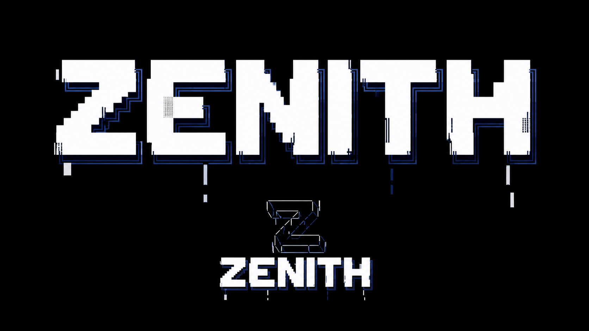

# Zenith

A local AI workspace for conversations, coding, research, and reviewed learning. Zenith brings open model runtimes, private memory, streamed responses, and evaluation tools into a single application for Windows and Linux.

**Release 0.14.1** · [Changelog](CHANGELOG.md) · [Installation](docs/local-installation.md) · [Model discovery](docs/model-discovery.md) · [Validation](docs/validation.md)

## Install

Run these commands in your terminal. Python 3.12 is recommended.

Windows PowerShell:

```powershell
winget install -e --id Python.Python.3.12
```

Reopen PowerShell after installing Python, then run:

```powershell
git clone https://github.com/jamescartel982-creator/Zenith.git
cd Zenith
py -3.12 install.py --mode local
powershell -NoProfile -ExecutionPolicy Bypass -File .\run.ps1 chat
```

If PowerShell says `git` is not recognized, install Git, reopen PowerShell,
and retry the clone command:

```powershell
winget install -e --id Git.Git
```

Linux:

```bash
git clone https://github.com/jamescartel982-creator/Zenith.git
cd Zenith
python3 install.py --mode local
bash run.sh chat
```

On Debian/Ubuntu, install `python3-venv` and Git if needed. The installer creates
and selects `.venv` automatically. No manual activation or paid API key is
required. The configured model downloads when first used; add `--download` to
the installer command to cache it during setup. Allow several GB of disk space
and about 4–6 GB of available RAM for the small local model.

On later visits, open the Zenith folder and run the same `run.ps1 chat` or
`bash run.sh chat` command. Type `/quit` to leave terminal chat.

To explicitly select the combined experimental candidate, append
`--activate-candidate` to the install command. This accepts its recorded quality
regressions, verifies and caches its weights, and saves a rollback receipt.
Existing settings and conversations are preserved. See
[installation details](docs/local-installation.md) for updates and other runtimes.

For browser chat, replace `chat` with `serve --open-browser` in the run command.
The local address is **http://127.0.0.1:7860**; keep its terminal open and use
Ctrl+C to stop the server.

### Runtime choices

| Installer mode | Runtime | Intended use |
| --- | --- | --- |
| `--mode local` | A small, pinned Hugging Face instruction checkpoint | First installation and CPU use |
| `--mode ensemble` | A configured model team with routing, review, and synthesis | Comparing collaborative response strategies |
| `--mode ollama` | An existing local Ollama server | Models managed by Ollama |
| `--mode localserver` | A compatible local llama.cpp or vLLM server | Separately downloaded model packs |

Local mode typically needs about 4–6 GB of available RAM and roughly 1 GB for weights. Append `--download` to cache the configured Hugging Face weights during installation; otherwise they download when first used. External runtimes must be installed and started separately. See [runtime setup](docs/local-installation.md) and [model packs](docs/model-packs.md).

## Workspace

- **Conversation:** streamed replies, code formatting, response budgets, and Fast or Thorough processing modes.
- **Memory:** local accounts, welcome-back greetings, private conversation history, and notes you explicitly choose to save or forget.
- **Model discovery:** search Hugging Face and GitHub on demand, including fine-tuned model repositories, and save selected source references locally.
- **Skills:** conversation profiles activated with `/skill list`, `/skill mathematics`, `/skill status`, or `/skill off`.
- **Owner controls:** defensive security profiles require the configured owner account and a current private admin-code unlock.
- **Learning and evaluation:** reviewed examples, versioned data splits, candidate training, regression checks, and recorded performance.

The System view shows the model, interface, context and memory, infrastructure and data pipeline, and governance and monitoring components. Engineering standards are implemented in the application and documented in [engineering](docs/engineering.md).

## Discover and configure models

Choose **Browse catalog → Search online**, then select Hugging Face or GitHub. Public model search includes base checkpoints, fine-tunes, adapters, merges, and quantized repositories. Source metadata and lineage appear when published by the author. The bundled catalog remains available offline.

```bash
zenith discover search --source huggingface --query Qwen
zenith discover search --source github --query "topic:llm"
zenith discover add --source huggingface --id OWNER/MODEL
zenith discover list
```

Replace `OWNER/MODEL` with the actual source identifier. Saving imports metadata into your local catalog; configure a compatible provider explicitly to run the selected model. Keep its original identifier and pinned revision. Model packs provide file manifests and optional verified downloads for compatible local servers.

Source APIs have access, pagination, and rate limits. A repository may require different hardware, an unsupported architecture, or additional licensing permissions. Discovery does not bundle every public model, execute repository code, merge weights, or train Zenith on source content. See [discovery and compatibility](docs/model-discovery.md).

## Verify and update

After activation:

```bash
zenith --version
zenith doctor
zenith verify
zenith verify --source .
zenith doctor --inference
```

`doctor --inference` tests a real response and may download the configured checkpoint. `verify` checks the installed wheel; `verify --source .` checks the source release inventory. Pip’s **“No broken requirements found” means its dependency check passed**. The installer presents that result as **“Dependencies verified. No package conflicts detected.”**

To upgrade, stop Zenith, activate `.venv`, run `git pull --ff-only`, then `python -m pip install --upgrade ".[local]"`. Run `zenith setup --activate-candidate` to select the bundled experimental checkpoint. Existing configuration and conversations are preserved. Without Git, use the [source ZIP](https://github.com/jamescartel982-creator/Zenith/archive/refs/heads/main.zip) and preserve any legacy checkout `data/` directory. See [upgrade instructions](docs/local-installation.md).

## Privacy and administration

Profiles and application data live under `%LOCALAPPDATA%\Zenith` on Windows or `~/.local/share/zenith` on Linux. `ZENITH_HOME` selects another location. Cached Hugging Face models support `HF_HUB_OFFLINE=1`; `ZENITH_DISCOVERY_OFFLINE=1` disables online discovery. Online search sends the query to the selected source; external model servers receive the context supplied to them.

Create a browser account, then configure the owner from your activated terminal:

```text
zenith admin init --username YOUR_USERNAME
```

The unique code is created locally and kept out of model prompts and Git. Sign in as the owner and unlock Admin before explicitly activating a protected security profile. Logout, locking, code rotation, and expiry revoke that access. See [administration](docs/admin.md), [skills](docs/skills.md), and [memory](docs/memory.md). Shared deployments require the authentication and network controls in [deployment](docs/deployment.md).

## Continued training and execution controls

The existing trained Zenith adapter can be verified and continued into a separate candidate with preserved architecture, tokenizer, and parent file hashes. The pipeline supports instruction tuning, domain-text continuation, reviewed preference pairs, historical replay, raw-model diagnostics, and local merge/export checks. It never promotes or publishes automatically.

The recovery study continues the existing checkpoint with instruction tuning, training-only replay, and reviewed preferences. One candidate reached 24/24 on the public diagnostics, while manual review and independent tests exposed further limitations; its failed quality decision is retained. Explicit experimental activation is available through `zenith setup --activate-candidate`. Promotion now checks individual cases as well as slice scores. See [measured recovery results](docs/model-recovery.md), [activation and rollback](docs/model-promotion.md), the [original pilot](docs/continued-training.md), and the [model card](docs/MODEL_CARD.md).

An [experimental research snapshot](research_checkpoints/recovery-v1/) includes the actual
continued adapter weights, original tokenizer, pinned base identity, and training
history. It is available for verification, further experiments, and explicit activation.
Installing the package preserves your selected model; `setup --activate-candidate`
records your exception for its known regressions. No candidate is relabeled as
having passed quality review.

Owner controls now include Argon2id password migration, authenticator-based MFA, explicit capability grants, narrow target scopes, activity records, bounded diagnostic plans, and emergency shutdown. Restricted execution starts disabled, including for the owner. Account-owned conversation summaries provide additional external context without changing weights. See [execution and memory controls](docs/execution-controls.md).

## Development and limitations

Zenith supports reviewed LoRA candidates and an experimental transformer trained from random weights. Training is explicit; ordinary chat does not update model weights. Evaluation and review determine whether a candidate should replace a baseline. The project does not claim comprehensive knowledge, professional certification, or performance parity with proprietary assistants. Response speed and quality depend on the configured model, hardware, context, and processing mode.

```bash
python -m pip install -e ".[test]"
python -m unittest discover -s tests -v
zenith catalog --validate
zenith skills validate
```

See [training](docs/quality-and-training.md), [training roadmap](docs/training-roadmap.md), [benchmarks](docs/benchmarks/v0.7/), and [validation evidence](docs/validation.md). Zenith’s code is licensed under [Apache-2.0](LICENSE); third-party model, dataset, and vendored-file terms remain applicable. The original starter archive is preserved in the repository.
