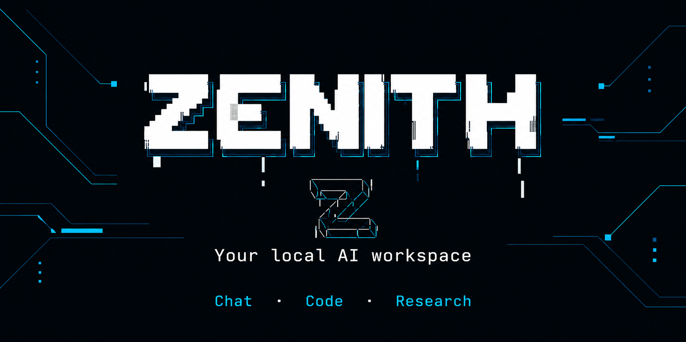
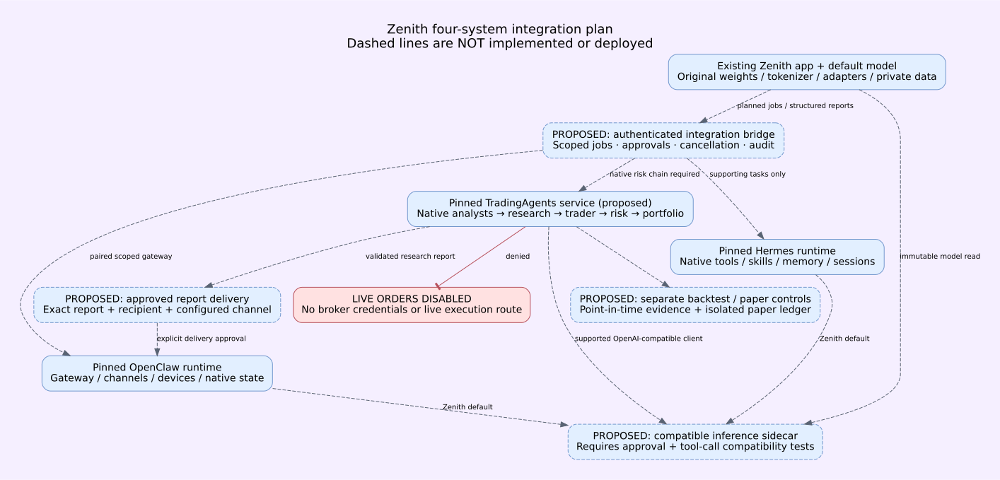
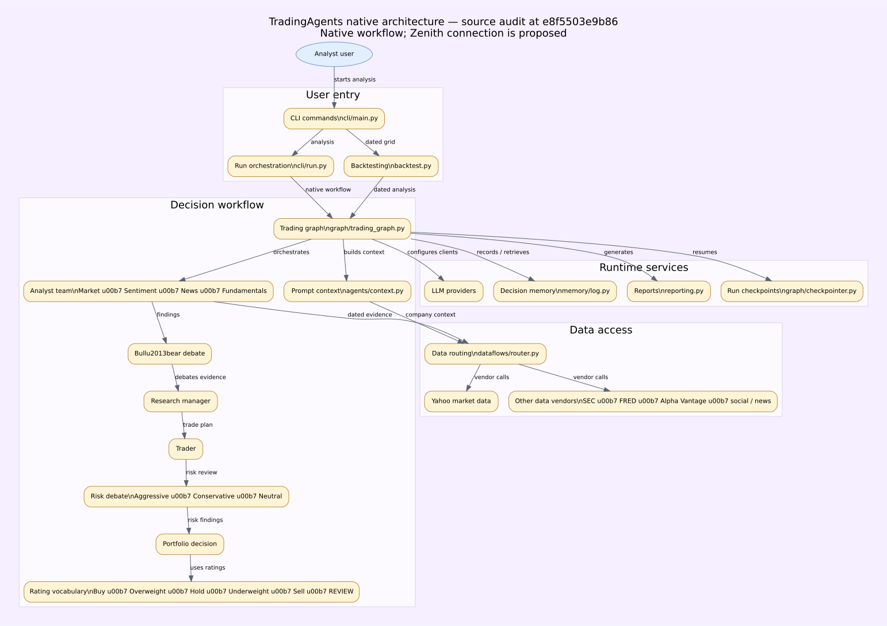

# Zenith

A local AI workspace for conversations, coding, research, and reviewed learning. Zenith brings open model runtimes, private memory, streamed responses, and evaluation tools into a single application for Windows, Linux, and supported Macs.

**Release 0.17.5** · [Changelog](CHANGELOG.md) · [Installation](docs/local-installation.md) · [Model discovery](docs/model-discovery.md) · [Validation](docs/validation.md) · [Security](SECURITY.md)

## Install

Run these commands in your terminal. Python 3.12 is recommended.

Windows PowerShell:

```powershell
winget install -e --id Python.Python.3.12
```

Reopen PowerShell after installing Python, then run:

```powershell
git clone https://github.com/n8storm/Zenith.git
cd Zenith
py -3.12 install.py --mode local
powershell -NoProfile -ExecutionPolicy Bypass -File .\run.ps1 chat
```

If PowerShell says `git` is not recognized, install Git, reopen PowerShell,
and retry the clone command:

```powershell
winget install -e --id Git.Git
```

Linux:

```bash
git clone https://github.com/n8storm/Zenith.git
cd Zenith
python3 install.py --mode local
bash run.sh chat
```

macOS (Apple Silicon, macOS 14+, native ARM64 Python 3.12):

```bash
brew install python@3.12 git
git clone https://github.com/n8storm/Zenith.git
cd Zenith
bash install.sh --mode local
bash run.sh chat
```

Homebrew must already be installed for the first command. The launcher selects
Python 3.12 automatically. For a browser window, double-click **Install
Zenith.command**, then **Start Zenith.command** on later visits. Intel Macs can
install the app with `bash install.sh --mode localserver` and explicitly configure
an independently running compatible backend; current secure native PyTorch wheels
are ARM64-only. See [Mac support and limitations](docs/macos.md).

On Debian/Ubuntu, install `python3-venv` and Git if needed. The installer creates
and selects `.venv` automatically. No manual activation or paid API key is
required. The configured model downloads when first used; add `--download` to
the installer command to cache it during setup. Allow several GB of disk space
and about 4–6 GB of available RAM for the small local model.

On later visits, open the Zenith folder and run the same `run.ps1 chat` or
`bash run.sh chat` command. Type `/quit` to leave terminal chat.

To explicitly select the combined experimental candidate, append
`--activate-candidate` to the install command. This accepts its recorded quality
regressions, verifies and caches its weights, and saves a rollback receipt.
Existing settings and conversations are preserved. See
[installation details](docs/local-installation.md) for updates and other runtimes.

### Runtime choices

| Installer mode | Runtime | Intended use |
| --- | --- | --- |
| `--mode local` | A small, pinned Hugging Face instruction checkpoint | First installation and CPU use |
| `--mode ensemble` | A configured model team with routing, review, and synthesis | Comparing collaborative response strategies |
| `--mode ollama` | An existing local Ollama server | Models managed by Ollama |
| `--mode localserver` | A compatible local llama.cpp or vLLM server | Separately downloaded model packs |

Local mode typically needs about 4–6 GB of available RAM and roughly 1 GB for weights. Append `--download` to cache the configured Hugging Face weights during installation; otherwise they download when first used. External runtimes must be installed and started separately. See [runtime setup](docs/local-installation.md) and [model packs](docs/model-packs.md).

Optional Hermes/OpenClaw development prerequisites have a separate
[pinned runtime setup](integrations/runtime_setup/README.md). This keeps their
Node, Python, and protocol test SDKs separate from the standard Zenith install.

## Native runtime integration status

Zenith remains the primary model. Hermes, OpenClaw, and TradingAgents have been
source-audited at pinned commits. Their original code, licenses, native state,
and dependency environments stay separate. The four-runtime bridge and compatible
inference sidecar are **planned, not operational**. Live trading is disabled.

[Audit](docs/four-system/AUDIT.md) · [Exact implementation plan](docs/four-system/FILE_BY_FILE_PLAN.md) · [Acceptance gates](docs/four-system/ACCEPTANCE.md)



The TradingAgents diagram below maps every component in the supplied reference
to its actual pinned source. Its native backtester scores historical decisions;
it is not a filled-order portfolio simulator. Historical data guards cannot
remove future knowledge already present in model weights.

<details>
<summary>TradingAgents native architecture and source map</summary>



[Component source map](docs/four-system/DIAGRAM_SOURCE_MAP.md) · [Native baseline](docs/four-system/BASELINE.md)

</details>

## Workspace

- **Conversation:** streamed replies, code formatting, response budgets, and Fast or Thorough processing modes.
- **Memory:** local accounts, welcome-back greetings, private conversation history, and notes you explicitly choose to save or forget.
- **Model discovery:** search Hugging Face and GitHub on demand, including fine-tuned model repositories, and save selected source references locally.
- **Skills:** conversation profiles activated with `/skill list`, `/skill mathematics`, `/skill status`, or `/skill off`.
- **Owner controls:** defensive security profiles require the configured owner account and a current private admin-code unlock.
- **Learning and evaluation:** reviewed examples, versioned data splits, candidate training, regression checks, and recorded performance.

The [productivity extension](docs/productivity.md) adds exact bounded CSV
summaries, explicit account response preferences and a searchable library with
capacity for 100,000 reviewed instruction profiles. The bundled library contains
32 profiles; imported instructions are not neural training or tool permissions.
Model size is reported from actual resident parameters when available.

To explicitly install **100,000 labeled generated workflow recipes**, run
`zenith skills recipes install --approve`. They are authored template
combinations with bounded search and owner-only security profiles; they are not
independently learned or evaluated abilities. See [installation, use and rollback](docs/generated-recipes.md).

For an existing recipe library, `zenith skills recipes optimize --approve`
refreshes SQLite query statistics. [Paired measurements](docs/benchmarks/recipe-search/README.md)
show gains on selected recipe searches; model inference and parameter count stay unchanged.

The System view shows the model, interface, context and memory, infrastructure and data pipeline, and governance and monitoring components. Engineering standards are implemented in the application and documented in [engineering](docs/engineering.md).

## Discover and configure models

Choose **Browse catalog → Search online**, then select Hugging Face or GitHub. Public model search includes base checkpoints, fine-tunes, adapters, merges, and quantized repositories. Source metadata and lineage appear when published by the author. The bundled catalog remains available offline.

```bash
zenith discover search --source huggingface --query Qwen
zenith discover search --source github --query "topic:llm"
zenith discover add --source huggingface --id OWNER/MODEL
zenith discover list
```

Replace `OWNER/MODEL` with the actual source identifier. Saving imports metadata into your local catalog; configure a compatible provider explicitly to run the selected model. Keep its original identifier and pinned revision. Model packs provide file manifests and optional verified downloads for compatible local servers.

Source APIs have access, pagination, and rate limits. A repository may require different hardware, an unsupported architecture, or additional licensing permissions. Discovery does not bundle every public model, execute repository code, merge weights, or train Zenith on source content. See [discovery and compatibility](docs/model-discovery.md).

## Optional model orchestration

The native-first [model registry and orchestrator](docs/platform-models.md) extend the existing providers with account-scoped discovery, explicit hybrid routing, collaborative drafts and model review. Ordinary installation and chat keep their existing configuration; external providers require separately configured credentials and explicit opt-in. No model weights or tokenizer are changed. See the [repository audit](docs/platform-audit/README.md) and [measured results](docs/platform-audit/results.md).

Authenticated Hugging Face Qwen2 conversations can reuse private attention state.
[Measured follow-up latency and configuration](docs/benchmarks/scoped-kv/README.md)
document roughly 9–14× gains on repeated long-context arithmetic, with unchanged weights
and exact paired answers. Fresh requests and other providers have separate limits;
this is not an overall platform speed claim.

## Optional bounded reasoning

Use `zenith reason "Explain this problem." --effort standard`, or explicitly choose Fast, Deep or Research effort. The [reasoning guide](docs/reasoning/README.md) describes candidate generation, separate review, exact arithmetic checks and owner-authorized restricted numeric code tests. All passes share a bounded budget; weights and existing installation settings are preserved. See [actual diagnostic results](docs/reasoning/native-diagnostics.json); the small native model does not reliably produce structured reviews, and no general quality or speed improvement is claimed.
## Optional supervised tasks

The optional [supervised task pilot](docs/platform/operations.md) adds authenticated
queued local chat, fixed diagnostic plans, exact-action network approvals, durable
task events and audit verification. It is disabled by default and preserves the
existing installation, provider, weights, tokenizer and data. See its
[implementation boundaries](docs/platform/architecture.md) and
[measured results](docs/platform/benchmark-results.md); autonomous tools, plugins
and browser/channel automation are not included in this stage.

## Optional isolated Python

The [isolated Python tool](docs/unified-platform/sandbox.md) runs explicit approved
programs in ephemeral offline Linux containers. It requires owner MFA, a scoped
grant, a reviewed pinned image and an explicit opt-in; queued executions also
require exact-action approval. Missing isolation never falls back to the host.
The [approved unified OpenClaw/Hermes audit](docs/unified-audit/README.md) tracks
remaining work. The existing Zenith model and normal installation are preserved;
full reference parity is not claimed.

## Verify and update

Cloudflare deployments use the optional [authenticated edge gateway](docs/cloudflare-deployment.md)
in front of Zenith's existing Python backend. The model and persistent state
remain on that backend; Wrangler does not host or replace the AI engine.

After activation:

```bash
zenith --version
zenith doctor
zenith verify
zenith verify --source .
zenith doctor --inference
```

`doctor --inference` tests a real response and may download the configured checkpoint. `verify` checks the installed wheel; `verify --source .` checks the source release inventory. Pip’s **“No broken requirements found” means its dependency check passed**. The installer presents that result as **“Dependencies verified. No package conflicts detected.”**

To upgrade, stop Zenith, activate `.venv`, run `git pull --ff-only`, then `python -m pip install --upgrade ".[local]"`. Run `zenith setup --activate-candidate` to select the bundled experimental checkpoint. Existing configuration and conversations are preserved. Without Git, use the [source ZIP](https://github.com/n8storm/Zenith/archive/refs/heads/main.zip) and preserve any legacy checkout `data/` directory. See [upgrade instructions](docs/local-installation.md).

## Privacy and administration

Profiles and application data live under `%LOCALAPPDATA%\Zenith` on Windows or `~/.local/share/zenith` on Linux. `ZENITH_HOME` selects another location. Cached Hugging Face models support `HF_HUB_OFFLINE=1`; `ZENITH_DISCOVERY_OFFLINE=1` disables online discovery. Online search sends the query to the selected source; external model servers receive the context supplied to them.

Privileged operations require the configured owner account and server-side authorization. Owner procedures are available in the authenticated owner workspace and trusted local terminal help. Credentials remain outside model prompts and Git. Logout, locking, credential rotation and expiry revoke privileged access. See [memory](docs/memory.md) and the [security policy](SECURITY.md). Shared deployments require the authentication and network controls in [deployment](docs/deployment.md).

## Continued training and execution controls

The existing trained Zenith adapter can be verified and continued into a separate candidate with preserved architecture, tokenizer, and parent file hashes. The pipeline supports instruction tuning, domain-text continuation, reviewed preference pairs, historical replay, raw-model diagnostics, and local merge/export checks. It never promotes or publishes automatically.

The recovery study continues the existing checkpoint with instruction tuning, training-only replay, and reviewed preferences. One candidate reached 24/24 on the public diagnostics, while manual review and independent tests exposed further limitations; its failed quality decision is retained. Explicit experimental activation is available through `zenith setup --activate-candidate`. Promotion now checks individual cases as well as slice scores. See [measured recovery results](docs/model-recovery.md), [activation and rollback](docs/model-promotion.md), the [original pilot](docs/continued-training.md), and the [model card](docs/MODEL_CARD.md).

An [experimental research snapshot](research_checkpoints/recovery-v1/) includes the actual
continued adapter weights, original tokenizer, pinned base identity, and training
history. It is available for verification, further experiments, and explicit activation.
Installing the package preserves your selected model; `setup --activate-candidate`
records your exception for its known regressions. No candidate is relabeled as
having passed quality review.

Owner controls now include Argon2id password migration, authenticator-based MFA, explicit capability grants, narrow target scopes, activity records, bounded diagnostic plans, and emergency shutdown. Restricted execution starts disabled, including for the owner. Account-owned conversation summaries provide additional external context without changing weights. See [execution and memory controls](docs/execution-controls.md).

## Development and limitations

Zenith supports reviewed LoRA candidates and an experimental transformer trained from random weights. Training is explicit; ordinary chat does not update model weights. Evaluation and review determine whether a candidate should replace a baseline. The project does not claim comprehensive knowledge, professional certification, or performance parity with proprietary assistants. Response speed and quality depend on the configured model, hardware, context, and processing mode.

```bash
python -m pip install -e ".[test]"
python -m unittest discover -s tests -v
zenith catalog --validate
zenith skills validate
```

See [training](docs/quality-and-training.md), [training roadmap](docs/training-roadmap.md), [benchmarks](docs/benchmarks/v0.7/), and [validation evidence](docs/validation.md). Zenith’s code is licensed under [Apache-2.0](LICENSE); third-party model, dataset, and vendored-file terms remain applicable. The original starter archive is preserved in the repository.
