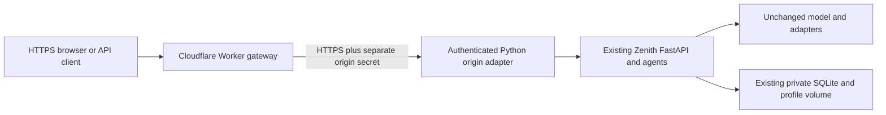

# Deploy the existing Zenith through Cloudflare

The [audit and file plan](cloudflare-deployment-plan.md) records the original
failure and architecture decision. Cloudflare deploys a transport Worker;
Zenith remains a normal Python application with its existing model, APIs,
authentication, agents and persistent SQLite/profile/model storage.



## What fixes the build error

`wrangler.jsonc` declares `integrations/cloudflare/worker.mjs` as `main`.
Wrangler no longer guesses a static-output directory. The Worker forwards `/`,
`/static/*`, `/api/*` and `/healthz` to the Python origin, keeping UI and cookies
on one public HTTPS origin. There is no frontend copy, rewritten model, D1
migration or simulated model implementation.

Python Workers support FastAPI, but this project's native PyTorch inference,
persistent files and process/container tool execution are not an unchanged
Python Worker application. Uploading `requirements.txt` or only `agent/web`
would not deploy the complete existing system.

## Fix `Zenith origin is not configured`

The exact error originates in `backend()` in
`integrations/cloudflare/worker.mjs`, before any backend request. The original
release used the same message for a missing/malformed `ZENITH_ORIGIN_SECRET`
and a missing/unparseable `ZENITH_BACKEND_URL`. It is a Worker configuration
failure, not evidence that Python inference was deployed or failed to load.

In **Cloudflare Dashboard → Workers & Pages → zenith → Settings → Variables
and Secrets**, add these **runtime bindings**, then select **Deploy**:

| Binding | Type | Required value |
| --- | --- | --- |
| `ZENITH_BACKEND_URL` | Text (or Secret if the hostname is private) | The separately deployed Python origin's HTTPS root, e.g. `https://origin.example.com`. This example is not a deployed service. |
| `ZENITH_ORIGIN_SECRET` | Secret | The same independent random 32–256 URL-safe-character secret configured on the Python origin. |
| `ZENITH_BACKEND_TIMEOUT_MS` | Optional Text | Integer 1000–120000; default 120000. This bounds time to response headers, not total streamed inference time. |

**Build → Variables and secrets**, local shell exports and `.dev.vars` do not,
by themselves, configure the published Worker's runtime bindings. Use the
settings of the actual deployed Worker/environment. The repository uses the
top-level `zenith` Worker, without a named Wrangler environment. If you add
named environments, provision bindings in each one. `keep_vars: true` preserves
dashboard text variables across this project's deployments; it does not create
them or deploy a Python backend.

The URL must not be the public Worker URL, its custom-domain alias, a frontend
route, an API subpath, a login page or an address redirecting back to the Worker.
The gateway rejects its own hostname (including alternate ports/trailing dots)
and detects authenticated requests routed back through an alias. Upstream
redirects are rejected instead of being followed or exposing private locations.
Inspect Cloudflare routes/custom domains/Tunnel routing as well: the origin's
hostname must terminate at the Python service, not match a wildcard Worker route.

The Python host needs the **same origin secret**, its independent existing
`ZENITH_API_TOKEN`, the exact public Worker hostname in `ZENITH_ALLOWED_HOSTS`,
and the `agent.cloudflare_origin` entry point described below. An unwrapped
`zenith serve` origin does not authenticate the gateway's transport headers.
Do not fix this by disabling the origin secret, exposing an unauthenticated
backend, switching model providers or putting the API credential in the Worker.

Investigation of source `713e53695c3e5eb5a95b09d536353517b5cd137e`
on 2026-10-30 confirmed that the GitHub-connected Worker deploy succeeded,
but found no running Python backend in this execution workspace. The Railway
connection requires reauthentication, and no reachable production backend URL
or authorized Cloudflare runtime-configuration access was available. Therefore
**public backend availability and inference remain unverified**. A stopped or
expired execution workspace is not permanent backend hosting. Provision or
reconnect the actual host before supplying its URL; do not invent a URL in Git.

Official configuration references:
[runtime variables](https://developers.cloudflare.com/workers/configuration/environment-variables/)
and [secrets](https://developers.cloudflare.com/workers/configuration/secrets/).

## Prepare the backend before publishing

Use an existing continuously running Linux/Docker host with sufficient RAM,
CPU/GPU, durable model cache and private persistent data. The existing small
CPU configuration generally needs 6–8 GiB; measure the actual chosen model.
Keep one process/replica per SQLite/model instance. This execution workspace
is not permanent hosting.

Keep the exact active model/revision, adapter mounts and profile paths from the
existing deployment. Back up private volumes and verify checkpoint hashes.
Do not start a fresh empty volume or accept default model settings as a
substitute for the existing Zenith checkpoint. Never copy keys, SQLite data or
weights into Git or a Worker bundle.

Configure these backend environment secrets/settings:

| Name | Purpose |
| --- | --- |
| `ZENITH_API_TOKEN` | Existing independent server access credential, at least 32 characters. |
| `ZENITH_ORIGIN_SECRET` | New independent random 32–256 URL-safe characters; only Worker and origin know it. |
| `ZENITH_ALLOWED_HOSTS` | Exact public Worker/custom hostname; include loopback hosts for maintenance if needed. No schemes, ports or wildcards. |
| `ZENITH_PUBLIC_ORIGIN` | Full public HTTPS origin, used by the optional Compose healthcheck. |
| Existing model/profile settings | Preserve provider, HF identifier/revision, adapter, data/profile/cache mounts and account state. |

For an existing Compose installation, use the **same Compose project and
existing volumes**, adding the overlay:

```bash
docker compose -f compose.yaml -f deploy/cloudflare/compose.origin.yaml config --quiet
docker compose -f compose.yaml -f deploy/cloudflare/compose.origin.yaml up -d --build
```

Retain any existing model-mount override files in both commands. The overlay
selects `python -m agent.cloudflare_origin` and supplies the new transport
configuration; it does not select another model or replace volumes. Protect
the loopback origin with a private HTTPS reverse proxy or named Cloudflare
Tunnel. A public Docker host must have a firewall and durable volumes.

For other platforms use the same existing image and optional entry point:

```bash
python -m agent.cloudflare_origin --host 0.0.0.0 --port 7860
```

That adapter rejects direct requests lacking the separate origin secret. Only
then does it validate and trust the public Host/HTTPS metadata supplied by the
Worker. It leaves the browser Origin and the application's account/owner gates
intact. Do not enable Uvicorn's arbitrary forwarded-header trust. The normal
`zenith serve` command remains unchanged for private installations.

The gateway copies Cloudflare's incoming `CF-Connecting-IP` into an overwritten,
authenticated transport header; the origin validates its IP type before using
it for rate limits. Arbitrary client `X-Forwarded-*`/`X-Zenith-*` values are
discarded. If Cloudflare removes visitor IP headers, limits conservatively share
the origin peer address. IP metadata never grants account or owner privileges.

## Configure and deploy the Worker

Use Node 24.19.0 (`.node-version`) and the lockfile's Wrangler 4.156.0:

```bash
npm ci
npm test
npm run check
```

The last command is a **local deployment dry-run**, not a live deployment.
Cloudflare builds can use build command `npm ci && npm test && npm run check`
and deployment command **`npx wrangler deploy`**, with repository root as the
working directory. The configuration's Worker name is `zenith`, matching the
existing failing build. `keep_vars` preserves dashboard variables; existing
secrets stay in Cloudflare. No account ID or token is committed.

Configure the Worker's `ZENITH_BACKEND_URL` to the backend's fixed HTTPS origin,
without credentials, a path, query or fragment. It must reach the authenticated
origin adapter, not another route back to this same Worker. Configure
`ZENITH_ORIGIN_SECRET` as a Worker secret with the same value as the backend:

```bash
npx wrangler secret put ZENITH_ORIGIN_SECRET
```

Enter it privately at the prompt or use the platform secret interface. Never
place secret values in command arguments, Git, query strings, logs or chat.
For CLI/CI authentication, configure least-privilege `CLOUDFLARE_API_TOKEN` and
`CLOUDFLARE_ACCOUNT_ID` through the execution platform's secret store. In an
interactive trusted local terminal, Cloudflare's supported OAuth login is an
alternative. Zenith's API token is not automatically inserted by the Worker;
clients still authenticate normally. No admin identity is granted by the edge.

Once the backend and secrets are ready, deploy:

```bash
npm run deploy
```

No backend or account is invented automatically. If runtime bindings are
missing, the deployed Worker returns a protected 503; this must not be described
as a working public Zenith installation. `ZENITH_TEST_LOOPBACK=1` is exclusively
for the isolated local test's loopback HTTP backend; never set it in production.
Public client traffic is HTTPS-only. Redirects from the backend are not followed
by the gateway. Cache bypass, bounded requests, header deadlines and native
response streaming protect the transport. Logs contain method/status/timing
and an opaque request ID, not request paths, bodies or credentials.

## Verify and monitor

- `GET /_edge/livez`: independent Worker liveness, even without origin settings.
  A 200 response only proves that the edge code runs.
- `GET /_edge/healthz`: gateway configuration check; 503 with setting names if
  missing/invalid, or 200 with `backend_verified: false` if syntactically valid.
  It does not contact the backend or establish its availability.
- `GET /healthz`: reaches the actual Python app, reporting its version/provider
  and model-loaded state. This is not an answer-quality benchmark.
- `/` and `/static/app.js`: must serve Zenith's original frontend.
- `/api/account` without server authentication: must return 401 on this public
  setup. Existing owner-only routes must remain inaccessible to ordinary users.
- Connect with the normal server gate, sign in and verify actual streamed model
  inference on the public URL before declaring deployment successful. Check that
  restart preserves the same account/database and model identity.

| Result | Meaning and next action |
| --- | --- |
| 503 `origin_not_configured` | Set the names listed in `required_settings` in Worker runtime settings; values are never returned. |
| 503 `origin_secret_invalid` | Replace the malformed origin secret on both sides with the same valid independent secret. |
| 503 `origin_url_invalid` | Use only the actual HTTPS origin root, without credentials, path, query or fragment. |
| 503/508 `origin_loop` | The origin points/routes back to this gateway; fix the hostname and Cloudflare route. |
| 502 `origin_unreachable` | Fetch failed; check DNS, TLS, firewall/Tunnel and the running Python service. |
| 504 `origin_timeout` | Python did not provide headers within the configured deadline; inspect host health and logs. |
| 502 `origin_redirect` | Origin redirected; configure the direct HTTPS service instead of a redirect/login/Worker route. |
| `/healthz` returns 403 | Check matching secrets, exact public hostname allowlist, and the origin adapter; also check host/proxy restrictions. |
| `/healthz` returns 200, `model_loaded: false` | Python responds, but model inference has not been demonstrated; authenticate and test a real answer. |

Local tests cannot set or validate production account bindings. A build, edge
liveness check, or configuration-only health check is insufficient for
acceptance. After runtime configuration, verify `/healthz`, preserved account
authentication and an actual model response through the **public** Worker URL.

The local acceptance command starts **real Wrangler/Workerd and real FastAPI**:

```bash
python -m scripts.smoke_cloudflare --output /tmp/cloudflare-local.json
```

Its model is explicitly a fixture. It verifies original UI bytes, HTTPS cookies,
origin authentication, CSRF, owner denial, streamed/persisted secret redaction
and disconnect. A separate real Wrangler run omits both runtime bindings and
checks protected 503 diagnostics plus independent liveness. It accepts only its generated local TLS certificate for this
isolated loopback test. Public verification must use normal certificate checks.
The CI workflow runs this acceptance plus Python/Worker tests and Wrangler
dry-run without production credentials. Passing local tests is not proof that
the public deployment is configured.

## Rollback and limits

Retain the previous Cloudflare Worker version before deploy and roll traffic
back through Cloudflare if validation fails. Restore the prior reviewed backend
image/command by removing the overlay; preserve all volumes and model mounts.
No database downgrade is needed. Rotate the origin secret on both sides together
if exposed. Never run a volume-deletion command to troubleshoot this integration.

The Worker is not an inference host, scheduler or permanent Python service.
Cloudflare proxy/time/plan limits and backend capacity still apply. It currently
transports the Zenith app's HTTP/SSE API; it does not claim to proxy every
independently deployed OpenClaw WebSocket interface. HTTPS, authentication and
headers reduce risk; they do not guarantee immunity to compromise.
