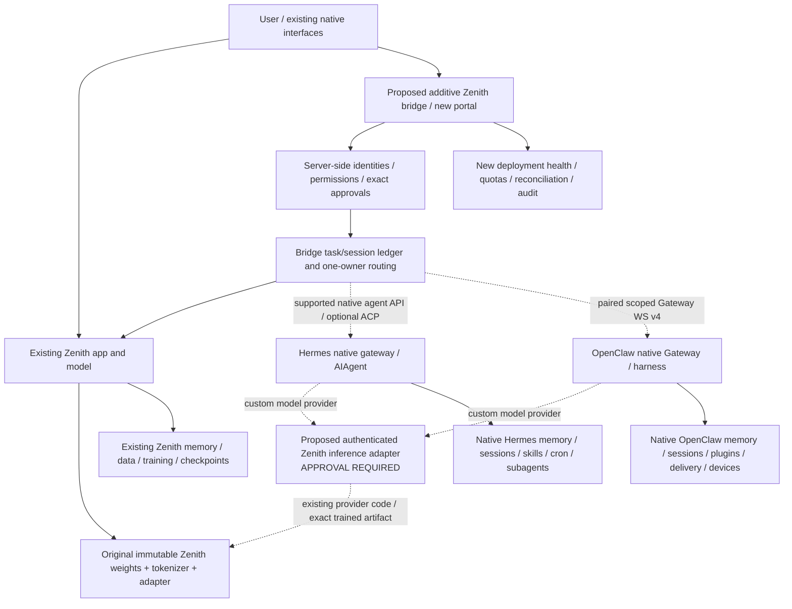

# Additive three-runtime architecture

**2026-10-26. Proposed additive overlay only; no integration code, existing configuration or source has been changed.** New inference service implementation requires the explicit approval specified in user Phase4. Original native source, features, state and licenses remain preserved.

## Ownership and layout

Create a **new sibling integration workspace** (proposed `/workspace/Zenith-runtime-bridge`) containing `integrations/`, its own pyproject/lock/configs/tests and operational definitions. Keep the three pinned repositories beside it, not flattened into Zenith, and use separately configured native installations. No replacement of Zenith Agent, Hermes AIAgent, OpenClaw Gateway/harness or any native subagent/memory/context implementation. This differs deliberately from the earlier Python-native reimplementation roadmap: this request preserves and interoperates with the complete native runtimes.

Original profiles, services, stores, UI assets and settings remain unchanged. Create explicit new integration profiles/volumes only after approval. They start with their own native state; they do not magically inherit or merge existing memories. Attaching an original profile or redirecting its model, exposing its UI or changing an installed service requires a concrete separately approved configuration change. No upstream patch is presently proposed.

Dotted links are proposed, not running integrations. Hermes/OpenClaw agent-facing HTTP APIs execute their agents; they must never be mistaken for foundation inference. Keep inference/service URLs and identities distinct to prevent recursive agent calls. Native original UIs remain their own surfaces. A new optional portal links/delegates to them; it does not replace their markup, settings or companion apps.

## Contracts and routing

Bridge envelope: actor/tenant (derived server-side), bridge task ID, selected backend/profile, native session/run IDs, operation capability, authorized target, deadline/resource budget, approval reference and original submission identity. Public client input cannot supply service credentials, role/elevation, runtime paths, model-provider overrides, native RPC method names or arbitrary callback destinations. Responses/events retain backend attribution, native event type/sequence, ack versus terminal outcome, source identity and untrusted output classification.

Session mappings key tenant+backend+native profile+conversation. Pin a conversation to its original runtime until explicit drained handoff. Cross-runtime delegation is a new separately authorized child task with a capability subset; native subagents within Hermes/OpenClaw remain entirely native. No automatic broadcast of effectful prompts or agent-response ping-pong. Optional read-only collaboration needs separately recorded IDs/budgets and cannot merge model weights.

Native idempotence is endpoint/mode/session/credential specific. Hermes canonical admission differs from legacy cache replay; OpenClaw chat.send binds its key to a physical session. Preserve the correct replay domain across retries; credential rotation, deletion/reset and uncertain acknowledgments require reconciliation. A transport timeout does not cancel admitted work. Use native cancel/status/approval paths, then reconcile ambiguous external writes before fallback. Never resubmit an uncertain accepted task to another runtime with a new key.

## Model service — explicit approval required

Source audit found no compatible raw inference endpoint in Zenith. Proposed **new** `integrations/inference/server.py` and contract modules expose authenticated `/v1/models` and `/v1/chat/completions` using the existing pinned Zenith provider implementation. They do not replace or modify agent/server.py, providers.py, weights, tokenizer or adapters. These paths describe the proposal, not endpoints currently present.

A new service instance loads the exact selected base+adapter once, verifies receipt/hash/tokenizer identity, runs offline where possible, and reports actual configured context/output/modality/tool limits. New Hermes/OpenClaw integration profiles point their supported custom model providers at it. The original Zenith app keeps its original provider/config: strict no-change may therefore mean **two process instances of the same trained model**, not one shared Python object. Consolidating the original app onto the new service would change its configuration and requires approval. Budget RAM/VRAM and cache mounts accordingly; never overwrite the original artifacts or activation receipt to fix path mismatches.

Protocol compatibility does not prove model competence. The selected text model's quality gates remain experimental, and native prompts/tool schemas may exceed its configured context budget. Baseline role/tool-history handling, structured tool calls, cancellation/streaming, token counts, errors and true context limits must pass against both actual runtimes. Do not silently flatten native tool history into user text, invent function calls, advertise arbitrary vision/embeddings, increase architecture limits, or substitute an external model. Unsupported fields/modalities fail explicitly. Any optional auxiliary provider requires its own legitimate access and explicit consent; Zenith remains default/primary.

## State and security

Keep native stores physically and logically separate. Bridge SQLite stores only its control metadata, identity/session mapping, delivery ownership, approval references and task/event/audit facts; it does not become a merged memory database or write upstream tables. No direct calls to private OpenClaw memory-host SDK or native SQL helpers. Profile-scoped retrieval stays native. Export/import across systems is a distinct consented supported operation, not automatic synchronization.

Each native system has a dedicated service identity and private state/secret volume. A bridge credential is not native per-tool authority. Prefer paired/scoped OpenClaw WS; shared-secret HTTP grants owner authority. Hermes API credentials/routes/profile scopes are native; verify required capabilities and approval delivery. Original direct UIs retain their native trust model. For untrusted tenants, use separate isolated runtime/profile boundaries, not one shared personal-owner secret plus a user header.

Run native effectful tools under supported native sandbox/configuration in an owned isolated runtime with network/host resource controls; Zenith's Docker tool does not automatically sandbox another process's terminal. Mediate actual native permission events where supported. If native policy cannot express a requirement without patching source, mark that contract blocked and request approval for the exact change. Preserve functionality rather than silently deleting tools and calling the result complete.

## Packaging / operational invariants

Use independent Python3.12 Zenith/inference, managed Python3.14 Hermes, Node26.12.1+ OpenClaw and optional bridge-client environments with exact lock/provenance. No blind manifest merge, global environment mutation or compulsory upstream install in the existing Zenith venv. An external overlay preserves every existing file. If the user instead requires root installer/UI/manifest integration, list those exact existing-file edits and obtain approval; do not exploit omissions in the current integrity manifest.

Keep native gateway/service owners. A new integration deployment must have unique owned names and selected new profiles; never restart original user services or fight their supervisors. Provider health failures may degrade availability without triggering duplicate effects or silent model substitution. Versioned deployments use new candidate copies; immutable pins and in-place native auto-update cannot both apply to the same running tree. Preserve native updater functionality in original/maintenance environments and review new pins separately.

## Existing Zenith identity reuse without changing its permissions schema

The integration should resolve current users/owner-MFA status through the original
protected read-only `/api/account` and `/api/admin/status` contracts where those
contracts satisfy the required authentication checks. Cookies/service access are
forwarded only to the pinned private Zenith origin, never to models or the other
runtimes. The bridge's new capability grants live in its own control ledger,
bound to a server-verified current native account/owner and expiry. The original
ExecutionControls has a fixed known capability set; it does not automatically
understand hypothetical hermes/openclaw grants. Do not patch that set, its account
schema or MFA behavior silently. If the read-only authentication contracts prove
insufficient, present an exact additional interface or explicitly configured
identity-provider decision for approval. Unavailable/revoked identity denies
bridge execution rather than retaining stale owner authority.
