# All supplied diagram components and proposed connections

**Design only; no cross-runtime connection is deployed.** All23 Hermes and32 OpenClaw labeled functional/external nodes are represented below. Organizational frame labels are regions, not endpoints. Native arrows describe simplified ownership relationships from the supplied diagrams/source audit, not an exhaustive call graph or a promise that each private box has a public API. Dotted edges are proposed additive public-interface/model links. Native source owners and exact preservation limits are in reports02/03 and the two machine-readable node maps.

```mermaid
flowchart TB
  U[User / new bridge portal]
  B[Proposed authorized bridge and task router]
  I[Proposed Zenith inference adapter - approval required]
  Z[Unchanged Zenith model artifacts]
  ZA[Existing Zenith app]
  ZD[Existing Zenith memory and training]
  U --> B
  U -->|native login or pairing| H01
  U -->|native login or pairing| O01
  U --> ZA
  ZA --> Z
  ZA --> ZD
  I -. existing provider code / same trained artifact .-> Z
  subgraph H[Hermes native system - preserve source and owners]
    H01["User"]
    H02["External model services"]
    H03["OpenAI-compatible API"]
    H04["ACP server [server.py]"]
    H05["ACP sessions [session.py]"]
    H06["ACP tools [tools.py]"]
    H07["Messaging platforms"]
    H08["CLI and TUI [console_engine.py]"]
    H09["Desktop app [main.ts]"]
    H10["Web app [App.tsx]"]
    H11["Messaging gateway [server.py]"]
    H12["Conversation loop"]
    H13["Model providers"]
    H14["Context engine [context_engine.py]"]
    H15["Context compression"]
    H16["Tool execution [tool_executor.py]"]
    H17["Terminal backends [local.py]"]
    H18["Agent memory [memory_manager.py]"]
    H19["Session search"]
    H20["Skills and learning"]
    H21["Trajectory generation [trajectory.py]"]
    H22["Subagents"]
    H23["Cron scheduler"]
    H01 -->|starts conversation| H08
    H01 -->|uses| H09
    H01 -->|uses| H10
    H01 -->|messages through| H11
    H07 -->|deliver messages| H11
    H04 -->|manages sessions| H05
    H04 -->|exposes tool activity| H06
    H04 -->|exposes Hermes agent| H12
    H03 -->|serves agent requests| H12
    H08 -->|submits turns| H12
    H09 -->|accesses agent| H12
    H10 -->|accesses native UI backend| H12
    H11 -->|routes turns| H12
    H02 -->|serves models| H13
    H12 -->|requests completions| H13
    H12 -->|manages context| H14
    H14 -->|delegates compression| H15
    H12 -->|dispatches tools| H16
    H16 -->|runs commands| H17
    H12 -->|uses memory| H18
    H12 -->|searches history| H19
    H12 -->|creates and improves| H20
    H12 -->|records trajectories| H21
    H12 -->|spawns subagents| H22
    H23 -->|delivers scheduled work| H11
  end
  subgraph O[OpenClaw native system - preserve source and owners]
    O01["User"]
    O02["Device nodes"]
    O03["Companion apps"]
    O04["Messaging channels / reply-pipeline.ts"]
    O05["Control UI"]
    O06["Gateway"]
    O07["Shared runtime state"]
    O08["Configuration / config.ts"]
    O09["Config schema / types.openclaw.ts"]
    O10["Work admission"]
    O11["Session management"]
    O12["Context lifecycle API / types.ts"]
    O13["Agent harness"]
    O14["Agent run registry"]
    O15["Context engine"]
    O16["Plugins and skills / registry-types.ts"]
    O17["Memory host SDK"]
    O18["Memory extension"]
    O19["Model providers / auth-storage.ts"]
    O20["Memory session bridge"]
    O21["Memory session API / engine-sessions.ts"]
    O22["Session-file access / session-files.ts"]
    O23["Credential storage / auth-storage.ts"]
    O24["Session cold storage"]
    O25["Delivery queue"]
    O26["Session routing / session-keys.ts"]
    O27["Session lifecycle"]
    O28["Transcript storage"]
    O29["Agent database"]
    O30["Cold transcript state"]
    O31["SQLite admission"]
    O32["SQLite transactions"]
    O01 --> O04
    O01 --> O05
    O03 --> O06
    O04 --> O06
    O05 --> O06
    O06 --> O02
    O06 --> O07
    O06 --> O08
    O08 --> O09
    O06 --> O10
    O06 --> O11
    O06 --> O13
    O13 --> O12
    O12 --> O14
    O13 --> O15
    O14 --> O16
    O15 --> O17
    O15 --> O18
    O13 --> O19
    O17 --> O20
    O18 --> O20
    O20 --> O21
    O21 --> O22
    O19 --> O23
    O11 --> O24
    O06 --> O25
    O11 --> O26
    O10 --> O27
    O11 --> O27
    O27 --> O28
    O28 --> O29
    O28 --> O30
    O24 --> O30
    O29 --> O31
    O30 --> O31
    O30 --> O32
  end
  B -. native HTTP / optional ACP .-> H03
  B -. optional editor ACP .-> H04
  B -. paired scoped WS4 .-> O06
  H13 -. custom provider .-> I
  O19 -. custom provider .-> I
```

The original Zenith app remains unchanged and may retain its own inference process. The added service uses the same preserved trained artifact for the two external runtimes; consolidating the original app requires separate config approval. Internal memory, credentials, sessions, context, SQLite, native tools/subagents/schedulers and UI implementations remain native. No private SDK endpoints are invented and no cross-system memory/credential merge is implied.
