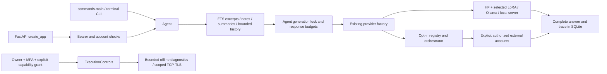

# Zenith current-main architecture

**Audit date:** 2026-10-25 UTC. **OpenClaw:** `2f5727b9c61c2ba9dccc3c880d9115f02cb8652f`. **Zenith main:** `e6963d9c6f45c196ae2e301819ae1ae093b35c41`. This is an audit/design deliverable; no Zenith implementation changes are authorized in this delivery.

**Evidence labels:** S = source-verified at the pinned commit; M = measured here; D = upstream documentation/policy claim; P = proposed design; H = hypothesis requiring implementation or experiment. Source inspection does not establish successful live execution.

## Audited boundary

The separately cloned current main is version **0.15.0**, commit `e6963d9c6f45c196ae2e301819ae1ae093b35c41`, with **375 tracked files** and **128 parsed Python modules**, no Python syntax errors in the inventory. The working development checkout remains at unmerged PR #18 (`ac989d869f2c2b961003684dc6ee7843d01d08da`, optional 0.16 reasoning). That PR is **not part of current main** and must be reconciled as a separate prerequisite if later approved; do not assume `agent/reasoning.py`, `agent/planning.py`, `agent/verification.py` or `verify-python` exist on the audited base. Evidence: source inventory, [agent/__init__.py:1](https://github.com/jamescartel982-creator/Zenith/blob/e6963d9c6f45c196ae2e301819ae1ae093b35c41/agent/__init__.py#L1), [pyproject.toml:1](https://github.com/jamescartel982-creator/Zenith/blob/e6963d9c6f45c196ae2e301819ae1ae093b35c41/pyproject.toml#L1).

## Preserved trained model

| Property | Recorded/current verification |
| --- | --- |
| Base | `Qwen/Qwen2.5-0.5B-Instruct` |
| Pinned base revision | `7ae557604adf67be50417f59c2c2f167def9a775` |
| Architecture | `Qwen2ForCausalLM`; 24 layers; hidden size 896 |
| Base parameters | 494,032,768 |
| Existing rank-8 LoRA addition | 4,399,104 parameters; total 498,431,872 |
| Native context ceiling | 32,768 tokens; configured request budgets are smaller |
| Tokenizer/embedding sizes | 151,665 tokenizer entries / 151,936 embedding vocabulary |
| Format | Original base safetensors plus PEFT LoRA safetensors and original tokenizer files |
| Adapter SHA-256 / bytes | `7e0701900b40109ee81b3dc097985cda360409006c8b717bda51830f3b6ed85d` / 17,640,136 |
| Tokenizer file SHA-256 | `9c5ae00e602b8860cbd784ba82a8aa14e8feecec692e7076590d014d7b7fdafa` |
| Semantic tokenizer signature | `221ea68122dfcfb2772276b69e62fc97ea9b13785ee069b118ee36498b19a418` |

S: The bundle manifest records training/adapter lineage, ordered weight parts, evaluation evidence and experimental status. Load verification rejects incompatible bases/tokenizers and missing/random replacement weights. The selected candidate retains its previously recorded numerical quality/retention failures and owner-approved experimental activation; no passing promotion is inferred. Sources: [research_checkpoints/recovery-v1/research.json:1](https://github.com/jamescartel982-creator/Zenith/blob/e6963d9c6f45c196ae2e301819ae1ae093b35c41/research_checkpoints/recovery-v1/research.json#L1); [agent/checkpoints.py:64](https://github.com/jamescartel982-creator/Zenith/blob/e6963d9c6f45c196ae2e301819ae1ae093b35c41/agent/checkpoints.py#L64); [agent/deployment.py:1](https://github.com/jamescartel982-creator/Zenith/blob/e6963d9c6f45c196ae2e301819ae1ae093b35c41/agent/deployment.py#L1).

M: Fresh offline checkpoint inspection and actual `4` / `Paris` inference succeeded from the cloned main code using the existing cached model and selected adapter. Exact architecture and file hashes are in `../evidence/zenith-model-verification.json`; no training/overwrite was performed. The base weights remain external cached artifacts, not source files automatically bundled into the Git repository. The experimental `TinyLM` path is an explicitly selected separate experiment, not the established Zenith foundation. Source: [agent/tiny.py:56](https://github.com/jamescartel982-creator/Zenith/blob/e6963d9c6f45c196ae2e301819ae1ae093b35c41/agent/tiny.py#L56).

## Current call graph

S: `Agent` owns storage/personal/admin/execution/skills/monitor instances and one generation lock. It builds context, streams or buffers model output, validates complete text, saves only completed turns and releases streams/locks on close. This intentionally limits concurrent inference through one Agent instance. It is not an autonomous tool-calling loop. Sources: [agent/core.py:27](https://github.com/jamescartel982-creator/Zenith/blob/e6963d9c6f45c196ae2e301819ae1ae093b35c41/agent/core.py#L27); [agent/core.py:73](https://github.com/jamescartel982-creator/Zenith/blob/e6963d9c6f45c196ae2e301819ae1ae093b35c41/agent/core.py#L73); [agent/efficiency.py:36](https://github.com/jamescartel982-creator/Zenith/blob/e6963d9c6f45c196ae2e301819ae1ae093b35c41/agent/efficiency.py#L36).

## Implemented owners and contracts

| Area | Existing owner / verified boundary |
| --- | --- |
| Inference | `providers.py` factory: HF/PEFT, Ollama, tiny, local server and opt-in orchestrated provider. Existing `generate(messages) -> (text, used_messages)` and stream tuple contract must remain. |
| Streaming | `transport.py` bounds SSE/NDJSON framing and requires provider completion; HF generation uses cancellation criteria, joins its worker, enables KV cache. |
| Model registry | `model_registry.py`, `model_capabilities.py`, provider adapters distinguish configured/account-listed/retired/unavailable. Exact IDs, optional environment credentials; text-only execution. |
| Federation | `orchestration.py`, `task_router.py`, `model_federation.py`: native-by-default optional routing, bounded retries, cooperative deadlines, circuit breakers, independent drafts/synthesis and fallible reviews. |
| APIs/UI | FastAPI/Uvicorn account/chat/review/admin/memory/catalog/system endpoints, SSE responses; existing HTML/CSS/JS UI. API gateway exists already, but lacks a durable task service and channel adapters. |
| Memory | `Store`, `PersonalStore`, `summaries`: one SQLite WAL database, FTS5 shared corpus, account notes and account/conversation summaries. No embedding/vector engine or project-memory permission model. |
| Skills | Validated resource/profile library and `/skill` commands; `SkillAccess` enforces protected-profile selection. Skills do not grant tool permissions or install executables. |
| Execution | Seven fixed capabilities: calculator, sha256, decode-base64, code-audit, inspect-url, tcp-connect, tls-certificate. Explicit owner/MFA/session-bound grants and emergency stop. No arbitrary shell, general sandbox, filesystem/browser/computer tool. |
| Monitoring | Bounded local per-account generation metrics/owner aggregate view; no distributed tracing or cryptographic audit-chain guarantee. |
| Training | CPT/SFT/DPO continuation, replay separation, checkpoint verification, compatible export, evaluation, explicit activation/rollback. Preserve these owners unchanged. |

Sources: [agent/providers.py:339](https://github.com/jamescartel982-creator/Zenith/blob/e6963d9c6f45c196ae2e301819ae1ae093b35c41/agent/providers.py#L339); [agent/transport.py:1](https://github.com/jamescartel982-creator/Zenith/blob/e6963d9c6f45c196ae2e301819ae1ae093b35c41/agent/transport.py#L1); [agent/model_registry.py:23](https://github.com/jamescartel982-creator/Zenith/blob/e6963d9c6f45c196ae2e301819ae1ae093b35c41/agent/model_registry.py#L23); [agent/orchestration.py:14](https://github.com/jamescartel982-creator/Zenith/blob/e6963d9c6f45c196ae2e301819ae1ae093b35c41/agent/orchestration.py#L14); [agent/server.py:124](https://github.com/jamescartel982-creator/Zenith/blob/e6963d9c6f45c196ae2e301819ae1ae093b35c41/agent/server.py#L124); [agent/storage.py:10](https://github.com/jamescartel982-creator/Zenith/blob/e6963d9c6f45c196ae2e301819ae1ae093b35c41/agent/storage.py#L10); [agent/personal.py:16](https://github.com/jamescartel982-creator/Zenith/blob/e6963d9c6f45c196ae2e301819ae1ae093b35c41/agent/personal.py#L16); [agent/summaries.py:1](https://github.com/jamescartel982-creator/Zenith/blob/e6963d9c6f45c196ae2e301819ae1ae093b35c41/agent/summaries.py#L1); [agent/skills.py:1](https://github.com/jamescartel982-creator/Zenith/blob/e6963d9c6f45c196ae2e301819ae1ae093b35c41/agent/skills.py#L1); [agent/skill_access.py:7](https://github.com/jamescartel982-creator/Zenith/blob/e6963d9c6f45c196ae2e301819ae1ae093b35c41/agent/skill_access.py#L7); [agent/execution.py:9](https://github.com/jamescartel982-creator/Zenith/blob/e6963d9c6f45c196ae2e301819ae1ae093b35c41/agent/execution.py#L9); [agent/monitoring.py:11](https://github.com/jamescartel982-creator/Zenith/blob/e6963d9c6f45c196ae2e301819ae1ae093b35c41/agent/monitoring.py#L11); [agent/continual.py:61](https://github.com/jamescartel982-creator/Zenith/blob/e6963d9c6f45c196ae2e301819ae1ae093b35c41/agent/continual.py#L61).

The OpenAI/Anthropic transport adapters currently reject unexpected tool outputs; `ProviderAdapter` is a trusted Python model-transport protocol, not a sandboxed third-party plugin manager. Sources: [agent/provider_adapters/openai_adapter.py:58](https://github.com/jamescartel982-creator/Zenith/blob/e6963d9c6f45c196ae2e301819ae1ae093b35c41/agent/provider_adapters/openai_adapter.py#L58); [agent/provider_adapters/anthropic_adapter.py:69](https://github.com/jamescartel982-creator/Zenith/blob/e6963d9c6f45c196ae2e301819ae1ae093b35c41/agent/provider_adapters/anthropic_adapter.py#L69); [agent/model_capabilities.py:90](https://github.com/jamescartel982-creator/Zenith/blob/e6963d9c6f45c196ae2e301819ae1ae093b35c41/agent/model_capabilities.py#L90).

## Authentication and persistence details

S: Account passwords use Argon2id with legacy migration on valid login. A high-entropy administrator code is separately stored as salted PBKDF2-HMAC-SHA256 (600,000 iterations), not the same Argon2 password hash. TOTP secrets are encrypted using a locally protected Fernet key; OTP replay is prevented with a stored step. Account session tokens are stored as hashes. A global server bearer token, account cookie, owner elevation and tool grant are separate trust levels. Sources: [agent/personal.py:12](https://github.com/jamescartel982-creator/Zenith/blob/e6963d9c6f45c196ae2e301819ae1ae093b35c41/agent/personal.py#L12); [agent/admin.py:31](https://github.com/jamescartel982-creator/Zenith/blob/e6963d9c6f45c196ae2e301819ae1ae093b35c41/agent/admin.py#L31); [agent/owner_mfa.py:29](https://github.com/jamescartel982-creator/Zenith/blob/e6963d9c6f45c196ae2e301819ae1ae093b35c41/agent/owner_mfa.py#L29); [agent/server.py:139](https://github.com/jamescartel982-creator/Zenith/blob/e6963d9c6f45c196ae2e301819ae1ae093b35c41/agent/server.py#L139).

`Store` owns `zenith.sqlite3` in persistent application data. Existing tables include turns, knowledge/FTS, users, login_sessions, conversation_owners, memories, summaries, skill_activations, human_reviews, admin_owner/elevations/audit, owner_mfa/sessions, execution_grants/state/audit, agent_tasks and generation_metrics. Schema setup is distributed through component constructors with `CREATE IF NOT EXISTS` and limited column checks, not a centralized versioned migration system. Several old inserts use positional `VALUES`, so adding columns to existing tables would break rollback/legacy writers. Plan additive `platform_*` tables instead.

Account notes/conversations are isolated. The imported `knowledge` corpus is intentionally shared, without per-user columns: do not advertise it as private project semantic memory, and do not route new private documents into that shared table. Sources: [agent/storage.py:34](https://github.com/jamescartel982-creator/Zenith/blob/e6963d9c6f45c196ae2e301819ae1ae093b35c41/agent/storage.py#L34); [agent/personal.py:92](https://github.com/jamescartel982-creator/Zenith/blob/e6963d9c6f45c196ae2e301819ae1ae093b35c41/agent/personal.py#L92); [agent/storage.py:150](https://github.com/jamescartel982-creator/Zenith/blob/e6963d9c6f45c196ae2e301819ae1ae093b35c41/agent/storage.py#L150).

## Deployment and measured baseline

S: Windows/Linux Git clone → `install.py --mode local` → existing launcher remains primary. The installer manages the virtual environment. Docker uses Python 3.11-slim, non-root UID 1000 and port 7860, with explicit token requirements for public binding in the server path; the container is an application package, not an untrusted-code execution sandbox. GitHub CI covers Python 3.10/3.12 Windows/Linux, native install/inference/activation/rollback and containers. Sources: [README.md:1](https://github.com/jamescartel982-creator/Zenith/blob/e6963d9c6f45c196ae2e301819ae1ae093b35c41/README.md#L1); [install.py:1](https://github.com/jamescartel982-creator/Zenith/blob/e6963d9c6f45c196ae2e301819ae1ae093b35c41/install.py#L1); [Dockerfile:1](https://github.com/jamescartel982-creator/Zenith/blob/e6963d9c6f45c196ae2e301819ae1ae093b35c41/Dockerfile#L1); [agent/server.py:1](https://github.com/jamescartel982-creator/Zenith/blob/e6963d9c6f45c196ae2e301819ae1ae093b35c41/agent/server.py#L1); [.github/workflows/tests.yml:1](https://github.com/jamescartel982-creator/Zenith/blob/e6963d9c6f45c196ae2e301819ae1ae093b35c41/.github/workflows/tests.yml#L1).

M: Fresh cloned-main regression suite: **243 tests, one skip, no failures, 34.864 seconds**. Offline CPU warm probes: original arithmetic 671.744 ms, geography 642.631 ms; native-orchestrated path 565.540 / 587.642 ms. Cold load 5.754 seconds. Both paths returned `4` / `Paris`, and artifact/profile inventories remained unchanged. Two warm observations are not a speedup claim, task benchmark or concurrency result. No OpenClaw integration was implemented; upgraded metrics are not available.
