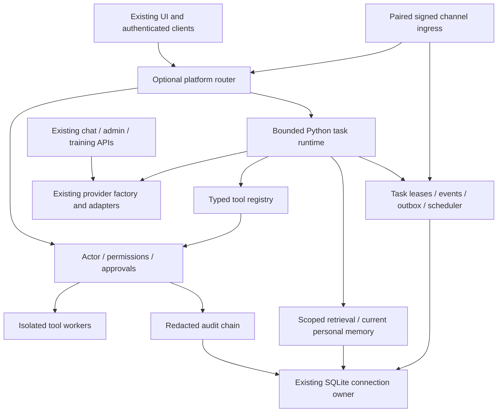

# Proposed Zenith integration architecture

**Audit date:** 2026-10-25 UTC. **OpenClaw:** `2f5727b9c61c2ba9dccc3c880d9115f02cb8652f`. **Zenith main:** `e6963d9c6f45c196ae2e301819ae1ae093b35c41`. This is an audit/design deliverable; no Zenith implementation changes are authorized in this delivery.

**Evidence labels:** S = source-verified at the pinned commit; M = measured here; D = upstream documentation/policy claim; P = proposed design; H = hypothesis requiring implementation or experiment. Source inspection does not establish successful live execution.

Everything in this document is **P**, except source references explicitly identifying existing owners. The design extends the current Python application; it does not import OpenClaw's runtime, change trained weights or merge unrelated models. All new subsystems are opt-in. No implementation is included in this delivery.

## Ownership and dependency direction

Existing owners remain authoritative: [agent/core.py:1](https://github.com/jamescartel982-creator/Zenith/blob/e6963d9c6f45c196ae2e301819ae1ae093b35c41/agent/core.py#L1), [agent/providers.py:1](https://github.com/jamescartel982-creator/Zenith/blob/e6963d9c6f45c196ae2e301819ae1ae093b35c41/agent/providers.py#L1), [agent/server.py:1](https://github.com/jamescartel982-creator/Zenith/blob/e6963d9c6f45c196ae2e301819ae1ae093b35c41/agent/server.py#L1), [agent/storage.py:1](https://github.com/jamescartel982-creator/Zenith/blob/e6963d9c6f45c196ae2e301819ae1ae093b35c41/agent/storage.py#L1), [agent/execution.py:1](https://github.com/jamescartel982-creator/Zenith/blob/e6963d9c6f45c196ae2e301819ae1ae093b35c41/agent/execution.py#L1), [agent/owner_mfa.py:1](https://github.com/jamescartel982-creator/Zenith/blob/e6963d9c6f45c196ae2e301819ae1ae093b35c41/agent/owner_mfa.py#L1). Provider adapters remain behind the existing registry. Neither model text nor plugin metadata may construct authenticated actors or grant records.

## Contracts and compatibility

A server-created `ActorContext` contains account, authenticated session reference, project, auth revision and scoped grant references. Secrets, raw session cookies and owner codes are absent. Channels map verified external identities to a pre-authorized Zenith identity; a global bearer token never becomes an administrator context. A request must satisfy both account ownership and the existing owner/MFA boundary when restricted tools are requested.

An optional `generate_turn(messages, tools, limits)` returns a typed `ModelTurn` with text, validated tool proposals, finish reason and provider-reported usage. Current `generate`/`stream` signatures and existing response envelopes remain valid. Model capability metadata must distinguish advertised schema support from executor-tested support. Existing OpenAI/Anthropic adapters reject tool outputs today; structured execution requires explicit adapter additions and transport tests, not removing that rejection globally. Native Zenith may propose strict JSON only behind a feature flag; malformed output fails closed and does not imply new trained tool competence.

A tool proposal references exact tool ID/version, bounded schema-validated JSON arguments, request/task ID and an idempotency key. It cannot contain arbitrary host commands. The registry declares effect class, sandbox requirement, target schema, runtime dependencies and output limits. Tool definitions and results are untrusted data, never executable policy. Stable tool catalogs may be exposed to a model while execution still checks live permission at every effect, reflecting [src/agents/agent-tools.turn-authority.ts:1](https://github.com/openclaw/openclaw/blob/2f5727b9c61c2ba9dccc3c880d9115f02cb8652f/src/agents/agent-tools.turn-authority.ts#L1) without copying its trust assumptions.

## Task state, cancellation and asynchronous gateway

Proposed durable lifecycle:

`queued → preparing → waiting_approval → running ↔ waiting_tool → completed | failed | cancelled | needs_reconciliation`.

Transitions use compare-and-swap version/lease fences and transactionally append scoped events. Recovery first checks the outstanding effect receipt. Read-only/idempotent work may retry within policy; uncertain external writes become `needs_reconciliation`, never blindly rerun. Cancellation is idempotent, propagates to children and workers, prevents further effects and records acknowledged cleanup. It cannot undo an already accepted external side effect.

Add `/api/platform/*` routes inside existing `create_app`, with passed authentication dependencies rather than a second security stack. Route examples: submit task, inspect/cancel task, replay bounded SSE events, approve a specific action, list own memory/jobs. Admission has queue/concurrency/token/tool-step/wall-clock quotas and returns explicit busy/unavailable errors. Async HTTP admission does not imply concurrent GPU generation: one existing HF worker/lock remains default. Provider-specific buffers, deadlines and token budgets belong to each request, not mutable shared settings.

SSE replay uses per-scope sequence cursors, retention and authorization on replay as well as live subscription. Progress can coalesce under backpressure; approval decisions and terminal outcomes persist before publication. An in-memory notification bus is an optimization over durable records, not the source of truth.

## Permissions, approvals and execution boundary

Roles are server-maintained: owner, member and narrow service identities. Each effect requires a compatible tool permission and target scope, plus current grants; restricted capabilities preserve owner MFA and emergency shutdown. High-impact writes, external messages, package activation, account changes and publication require action-specific human approval. The approval binds account, tool/version, canonical argument digest, destination, expiry, one-use nonce and idempotency key. Any post-approval argument transformation invalidates it. After awaited preparation and immediately before effects, recheck session/auth revision, expiry, emergency state and target scope.

Do not embed admin secrets in prompts, let model output call role/grant mutation, or treat a skill as a grant. Scheduled and child runs cannot inherit cookie/MFA authority implicitly. A separate explicit standing service grant is required for an approved scheduled effect, with fixed targets, expiry, quotas and revocation; initial scheduler supports read-only work only.

General code/plugin workers run through a rootless container broker with pinned approved images, no host fallback, non-root UID, read-only root, dropped capabilities, seccomp, no Docker socket or home/config mounts, private temporary workspace and CPU/memory/PID/output/time limits. Default network is none. Allowed external access requires a separate egress broker and target policy. Missing container support on Windows/Linux makes execution unavailable while text chat and existing bounded diagnostics continue. A container is a useful boundary, not a demonstrated defense against every kernel exploit; hostile workloads may require a dedicated VM.

## Persistence and memory

Use the current SQLite WAL connection owner. Add versioned `platform_*` tables for projects/memberships, tasks/leases/checkpoints, approvals, events, tool receipts, jobs, ingress deduplication/outbox, plugin approvals and scoped documents/chunks/FTS. Do not alter positional-insert legacy table shapes. A new migration ledger owns only these tables. Migration is transactional, idempotent and tested against a copied old database; backups use SQLite's consistent backup API, not copying only a live WAL main file.

Existing account notes and summaries are read through existing ownership checks. The old shared knowledge corpus stays explicitly shared. Private project documents go into scoped new tables with ACL filters **before** ranking and joining source contents. Deduplicate within the correct owner/project scope; provenance includes source digest, ingestion version, consent/license reference and expiry. Deletion removes text, chunks, embeddings, task-context caches and queued exports. Existing shared data is never silently reclassified or moved.

FTS5 is the first retrieval backend. Optional embeddings store derived vectors in the same logical store/cache with model/revision/license and index version. Choose a model only after retrieval and cost/CPU benchmarks justify it. Lexical fallback remains usable without model downloads. Context management applies token budgets and quoted provenance; summaries are lossy evidence, not new authoritative instructions or weight updates.

## Plugins and skills

Load and validate a bounded manifest before any code. Pin package hashes/versions, dependencies, origin and requested effects. Review approval binds manifest + artifact digest; updates require reapproval. Reject traversal/symlink/oversized archives, unknown entry points and unsupported schemas. Signatures establish provenance, not safety. No untrusted Python import in the gateway. Executable plugins use a versioned framed JSON worker protocol in the sandbox, with bounded discovery/results, deadlines and shutdown. Existing trusted provider adapters remain supported independently.

Skills remain bounded untrusted instructions/resources. Package installation cannot grant tools, network or admin privileges. Prompt-injection scanning/wrapping is defense in depth; the effect gate remains authoritative. Do not copy OpenClaw skill code/assets without scoped license review. No general remote skill marketplace auto-install.

## Multi-agent, events, scheduling and messaging

A parent may create child tasks with distinct workspace/session identity and explicit strict-subset delegation; budget/deadline/cancellation are inherited downward, never expanded. A coordinator records dependencies/results and synthesizes only task data. Multi-agent roles are not separate foundation models; existing model federation remains a different subsystem.

Scheduler v1 supports persisted one-shot and fixed-interval UTC jobs, overlap limits, lease-fenced claims and explicit missed-run policy. Full cron/timezone/DST rules are a later separately tested extension. Persist ingress deduplication and outbox with task results atomically. Network sends carry provider idempotency keys where supported; timeout after acceptance is uncertain and requires reconciliation. Do not promise exactly-once third-party delivery.

Channel adapter v1 contract: validate signature/replay bounds, map paired sender/account/chat/thread, persist bounded inbound envelope, submit scoped task, create an approved outbound delivery. First Telegram owned-test bot, then Slack signed webhook and Discord interaction subsets; rich realtime/voice parity is out of scope. Credentials remain in environment/secret storage, absent from prompts and ordinary audit logs. Integration availability is explicit until a real account passes E2E tests.

## Browser and computer automation

Browser tools use a separate isolated Playwright worker/profile and a controlled egress broker. Enforce destination policy across redirects, DNS resolutions, IPv4/IPv6, subresources and WebSocket/WebRTC paths; deny private/link-local/metadata destinations unless a deliberately scoped owned lab policy permits them. Browser content cannot approve actions. Write clicks, uploads, downloads and message submissions require action approval and bounded workspace paths. No host Chrome profile, keychain or cookie import.

Computer automation requires a disposable VM desktop with restricted display/input transport and network policy. It is a separate feature, unavailable by default and unsupported until a compatible backend and escape/cancellation tests are demonstrated. Do not substitute unrestricted control of the owner's real desktop.

## Dashboard, monitoring, secrets and delivery

Extend Zenith's existing plain-JS dashboard with task status, model attribution, tool approvals, memory deletion, jobs and adapter availability. Keep chat endpoints, visual identity and installation flow. Never display an inaccessible proprietary model as active.

Record task/span IDs, durations, queue/wait times, reported token usage, budget exhaustion, cancellations, tool decisions and error classes. Unknown provider usage remains unknown. Optional OpenTelemetry export is off and redacted by default. A metadata-only HMAC audit chain with protected key and externally retained anchors detects covered record modifications under stated assumptions; it does not defeat a root attacker holding the key or prevent deletion without an external anchor. Persist approval receipts before high-impact effects; failure to persist causes denial, not an unlogged fallback.

## Rollout and rollback

All platform flags start false, including owner execution. Enable only the completed milestone after unit, integration, security and real-path E2E gates. Rollback first denies new admissions, cancels/drains workers and revokes standing grants, then disables flags and restores code compatibility. Leave additive tables intact; old main must still read its existing data. Whole-database restoration is a last resort requiring an explicit plan for post-backup user changes. No checkpoint/config reset, retraining, auto-promotion or new default model occurs.

The optional OpenClaw bridge is deferred, read-only first, pinned protocol/version, separately authenticated and scope-filtered. It is not required for native capabilities, not MCP by assumption, and not proof of arbitrary OpenClaw plugin compatibility.
