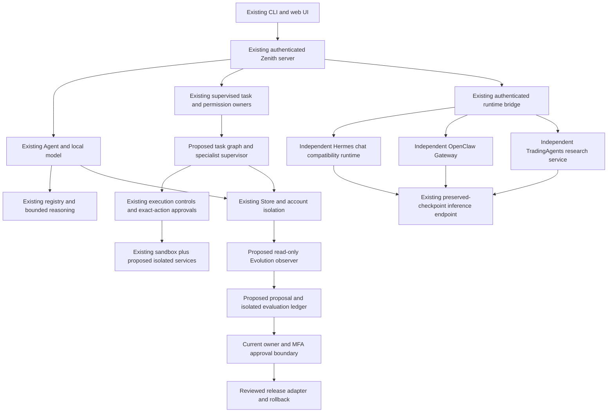

# Additive architecture specification

This is a proposal grounded in the pinned repository, not a new runtime installed
by this audit. Existing model architecture, tokenizer, adapters, selected profile,
providers, APIs and independent upstream source trees remain authoritative.

## Current owners to retain

| Concern | Existing owner | Extension rule |
| --- | --- | --- |
| Conversation/inference | agent/core.py, providers.py, tokenization.py, efficiency.py | Retain generate/stream and current defaults; add optional structured tool-loop adapters outside weights. |
| Provider routing | model_registry.py, task_router.py, orchestration.py, provider_adapters/ | Reuse exact IDs, privacy/cost/context/access filters; no automatic model substitution. |
| Reasoning | reasoning.py, planning.py, verification.py | Extend bounded checks and plans; model critique remains untrusted. |
| Storage | storage.Store + personal.py + summaries.py | One existing SQLite owner; preserve legacy layouts/WAL and account ownership. |
| Task control | runtime.py, task_store.py, event_bus.py, approvals.py | Reuse durable intent/receipts, fences and cancellation; expand in opt-in modules. |
| Authority | admin.py, owner_mfa.py, execution.py, permissions.py | Use live server-derived owner/session/MFA/capabilities; never prompt roles. |
| Isolation | sandbox.py, sandbox_docker.py, restricted_python.py | No host fallback; broader workspaces require separately verified policies. |
| Learning | curriculum.py, continual.py, checkpoints.py, quality.py, deployment.py | Reuse immutable parent lineage, disjoint data, candidate gates and rollback. |
| Native runtimes | integrations/runtime_bridge, inference_service, hermes_compat, openclaw_provider, trading_service | Preserve independent deployment/state/credentials and current restricted scopes. |
| UI/operations | agent/web/, monitoring.py, deploy/four_system/ | Extend current interface; liveness is distinct from readiness and availability. |

## Proposed module structure

```text
agent/
  evolution/                   # new controlled improvement owner
    config.py contracts.py migrations.py repository.py
    observer.py discovery.py proposals.py experiments.py
    evaluator.py approvals.py releases.py training.py gateway.py
  project_memory.py project_memory_migrations.py semantic_memory.py
  context_manager.py document_index.py repository_index.py
  repository_analysis.py knowledge_graph.py graph_retrieval.py graph_migrations.py
  plan_graph.py task_graph.py task_graph_migrations.py recovery.py
  supervisor.py agent_registry.py collaboration.py task_artifacts.py tool_loop.py
  research_agent.py research_fetch.py source_verifier.py citation_manager.py
  data_analysis.py infrastructure_tools.py
  terminal_tools.py sandbox_workspace.py language_tools.py
  coding_agent.py patch_manager.py test_runner.py task_checkpoint.py
  github_client.py github_tools.py architecture_analysis.py
  scheduler.py scheduler_migrations.py outbox.py
  evidence_sufficiency.py claim_verifier.py routing_metrics.py
  performance.py gpu_metrics.py
  security/
    operations.py logs.py vulnerabilities.py threat_intel.py feeds.py
    assessment.py incident_response.py evidence.py malware.py
  multimodal/
    documents.py vision.py ocr.py audio.py speech.py images.py video.py
  voice_session.py voice_gateway.py media_history.py video_index.py
  browser_tools.py desktop_tools.py mcp_tools.py
  role_policy.py agent_policies.py role_migrations.py memory_gateway.py
integrations/
  browser_service/              # independent sandboxed Playwright environment
  desktop_service/              # independent OS permission broker
  mcp_service/                  # official-SDK transport/isolation boundary
  malware_lab/                  # stronger disposable VM lab; blocked until proven
  devtools/                     # reviewed language toolchain images/manifests
tests/
  test_evolution_*.py test_*_memory.py test_*_graph.py ...
  security/ multimodal/ integration/
```

These are exact proposed destinations, not files to fill with empty classes.
Each capability's dependencies, tests, flag, expected behavior and rollback are
listed in [IMPLEMENTATION_PLAN.md](IMPLEMENTATION_PLAN.md). New `__init__.py` and
packaging discovery changes belong to each actual implementation PR when needed;
none should activate optional components at import.



## Integration contracts

**Model interface.** Preserve current `generate(messages)` and
`stream(messages, cancellation)` behavior. Scoped attention reuse stays internal
to authenticated account/conversation calls. New structured tool calls must use
validated names/arguments and preserved call IDs; generation never authorizes
execution. Reuse the independently packaged inference service where its tool
contract is needed; do not silently add a Python-3.12-only dependency to the
Python-3.10 root path. Tool-loop support must demonstrate a real model round trip
before an agent is marked available.

**Tool boundary.** `agent/tool_loop.py` is a proposed bounded loop, not a new
privilege system. It submits proposals to existing Permissions/ExecutionControls,
checks exact-action approvals, then interprets bounded results as untrusted data.
New capability names and schemas require reviewed changes to execution.py,
tool_protocol.py and tool_registry.py. Browser/desktop/MCP text cannot register
itself or enlarge its grants. No recursive unrestricted agent/shell entrypoint.

**Task contract.** A task carries server-derived owner, project/conversation,
goal/constraints, budget, source/configuration hashes, dependency IDs, cancellation
state, completion checks and artifact references. Child authority is the
intersection of parent delegation, registered specialist policy and current
server permissions. A model may request a plan; only the controller admits it.

**Memory contract.** Extend the existing Store. Keep shared approved corpus
semantics separate from new account/project-private documents. Reuse reserved
platform document tables only after their actual service and isolation tests
exist. Add component migration namespaces rather than altering platform v1's
checksum. Semantic encoders produce retrieval scores/text spans; they are not
assumed compatible with Zenith's language embeddings. Native runtime memory
stays separate unless a user explicitly approves a scoped import/export.

**Artifact contract.** Use immutable digest/size/type/provenance references with
owner/project ACLs, approved retention and bounded extraction. Never pass host
paths, raw secrets or another agent's entire filesystem as shared context.

**Events and metrics.** Add normalized, versioned metadata events with request,
task, parent-task, experiment and configuration IDs. Preserve original sources;
do not substitute an event bus for native runtime sessions. OpenTelemetry may be
an optional export later, with redaction and bounded cardinality; no hidden
reasoning traces, credentials or raw prompt bodies enter telemetry.

**API/UI.** Keep existing routes and response meanings. New route groups such as
`/api/evolution` are proposed, opt-in and authenticated; they do not exist yet.
Use one installed API router per subsystem and current security middleware.
Surface configured/available/verified/blocked states independently. The default
UI and text-only installation must work when every new flag is off.

**Native compatibility.** Full native Hermes tool execution cannot be inferred
from the approved chat-only context build. Its 64K assumption conflicts with the
unchanged 32K model. Any broader compatibility change needs a separate reviewed
proposal and acceptance; do not inflate the context advertisement or modify the
original upstream checkout. OpenClaw features remain selected native backends,
not generic replacements. TradingAgents remains financial research only; no
broker or live-order adapter is introduced by this plan.

## Dependency and compatibility gates

Before each implementation PR: identify existing API owners; record source and
model identities; inspect relevant environment locks; add optional dependencies
in an independent environment; test disabled-state compatibility; verify actual
backend behavior on supported platforms; include migration, approval and rollback.
When hardware/credentials are absent, report BLOCKED instead of promoting a mock
test to an integration claim. Keep unsupported specialist entries unavailable.
