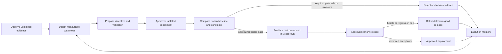

# Controlled Zenith Evolution Engine design

Status: **proposed**, not implemented or activated. Extend the existing metrics,
feedback, task, training, checkpoint and authorization owners. The first release
observes metadata and proposes work only. It cannot edit production, train,
deploy, migrate schemas, grant permissions or publish releases.

## Workflow and state machine

Proposal states: `draft -> validated -> awaiting_experiment_approval ->
experiment_running -> evaluated -> rejected | awaiting_release_approval ->
canary -> deployed | rolled_back`. Cancellation, failure and
`needs_reconciliation` are explicit terminal/review states. Transitions use a
database compare-and-swap revision and append an audit event atomically. No
model output, dashboard checkbox or failed test can skip a state.

An experiment passing tests is not approval to deploy. An existing owner login
is not a capability grant. A broad development approval in a conversation does
not become a reusable authentication token inside Zenith.

## A. Performance observer

`agent/evolution/observer.py` reads bounded metadata from existing
generation_metrics, task states/receipts, user-approved feedback, evaluation
reports, security/advisory findings and separately configured resource sensors.
Collect success/failure counts, categorical errors, request latency, visible-text
latency, actual token usage, resource observations and configuration identities.
Do not infer task success from HTTP 200 or model self-confidence.

Use bounded batches, monotonic observed timestamps and idempotent event keys.
Keys include source namespace, source ID, creation time and canonical record hash;
metrics IDs alone can be reused after deletion. Detect retention gaps/reset
cursors rather than silently omitting events. Preserve source retention/deletion
semantics. Default events exclude prompts, responses, login cookies, tool input,
credentials, screenshots and raw personal memories.

GPU observations remain `unavailable` without real hardware/sensors. Cost remains
unknown when prices or local compute cost are not measured. No fabricated zero
cost, accuracy, utilization or throughput fills a missing metric.

## B. Weakness discovery

`discovery.py` initially uses deterministic rules with evidence thresholds:

- Repeated classified failure within a stable configuration/workload cohort.
- Lower task success or higher error rate on frozen comparable evaluations.
- Retrieval misses against labeled relevant source IDs, not model complaints.
- Latency/resource regressions with cold load, prompt/output length, cache state
  and hardware recorded separately.
- Scan coverage gaps, authorization failures, lease/reconciliation growth and
  resource-capacity signals.

Each finding includes source event IDs/hashes, sample size, observation interval,
configuration and uncertainty. Suggested rules are versioned and benchmarked.
Model summaries may explain a finding, but cannot convert an unsupported
hypothesis into a measured weakness. Sparse or non-comparable data yields
`insufficient_evidence`, not an automatic optimization task.

## C. Improvement proposals

`contracts.py` and `proposals.py` validate bounded structured proposals:

| Field | Required meaning |
| --- | --- |
| id / schema_version / revision | Controller-generated identity and optimistic concurrency version |
| owner_id / project_id / author_type | Server-derived scope; model text cannot set authority |
| baseline | Git SHA/tree, model/tokenizer/adapter hashes, dependency lock hashes, workload/configuration hashes |
| objective / weakness_ids | Measurable task and actual evidence references |
| hypothesis / expected_benefit | Explicitly estimated effect; never represented as a result |
| category | Prompt, workflow, retrieval, code, tool, routing, dataset or training |
| implementation_plan | Exact destination paths, dependencies, bounded experiment steps |
| risk / protected_resources | Privacy, security, numerical, compatibility and rollback risks |
| validation | Frozen suite/scorer versions, required metrics/slices and hard gates |
| budget | Calls/tokens, wall time, CPU/RAM/VRAM, storage, concurrency and known cost cap |
| permissions | Requested existing capabilities/scopes and sensitive actions requiring separate approval |
| rollback | Known-good release/checkpoint identity, state handling and verification |

Proposal text, patches, tool results and user feedback are untrusted inputs.
Reject unknown fields, arbitrary commands, traversal paths, secret-like material,
missing validation, unlicensed datasets, unavailable backends and contradictory
resource requirements. A proposal can request capabilities; it cannot create
grants, select its own administrator identity or change protected-path policy.

## D. Isolated experiments

`experiments.py` owns experiment admission and the sandbox adapter; it does not
duplicate ExecutionControls. A trusted controller creates a new temporary Git
worktree or clean archive at an exact baseline commit, with hooks disabled and
no production credentials/configuration/database copied into the worker. The
sandbox receives immutable source/test fixtures and narrowly approved model
service access only when required. Never mount the host Docker socket or a
writable production checkout.

Reuse the existing reviewed image-ID Docker policy and add a separately tested
workspace/artifact adapter. Tests, package build hooks, repository scripts and
generated patches are arbitrary code: run them in that isolated environment.
Use structured command specifications, an offline locked wheel/toolchain store,
no default network, CPU/RAM/PID/storage/output quotas, a process-owned deadline
and cancellation with confirmed cleanup. No missing-backend host fallback.
Hostile malware requires a stronger separate VM lab.

Experiments produce immutable patch, stdout/stderr summaries, test reports,
resource observations, dependency/configuration hashes and model identity
receipts. Extract artifacts by validated type/path/size/hash, rejecting symlinks
and archives that escape the workspace. Redact before exposure to a model/UI.
Crash after an unknown effect remains `needs_reconciliation`; do not replay it.

The first observer-only milestone does not run these experiments. Granting
experiment execution comes in a later PR with real containment acceptance.

## E. Evaluation gates

`evaluator.py` compares an immutable baseline and candidate on identical frozen
workloads/scorer versions. Separate model-only, deterministic-tool and full-agent
paths. Record actual values and unavailable measurements. Required gates include:

- All protected original model/tokenizer/source identities remain unchanged.
- Candidate model lineage, if training was separately authorized, descends from
  the exact verified existing trained checkpoint and preserves architecture and
  tokenizer compatibility.
- No unauthorized effects, secret exposure, cross-account/project access,
  permission escalation or bypass of emergency shutdown in regression tests.
- Declared accuracy/completion/retention slices meet pre-registered thresholds;
  critical regressions fail even when the overall average improves.
- Task-specific correctness and integration tests pass; unit tests alone cannot
  verify a real provider, toolchain, browser, desktop, media engine or channel.
- Resource/cost budgets and latency/error-rate limits are met on comparable
  hardware/workloads. Unknown required metrics block approval.
- Privacy, licensing/provenance and train/validation/final-test isolation hold.

Example metric families: reasoning correctness/calibration, coding hidden-test
success, tool/schema correctness, approved task completion, retrieval recall and
source support, security false-positive/false-negative rates, TTFT/TPS/latency,
peak RSS/VRAM, GPU utilization, error rate and cost per successful task. Security
boundaries are hard gates, not a weighted reward the model can trade away.

Current v1 grader issues must be addressed with a **new scorer/suite version**.
Keep exact-format and semantic-format tests distinct, retain old raw scores and
include negative controls; do not inflate results by silently relaxing an old
benchmark. The evaluation controller/scorers, approval policy and protected-path
list are themselves protected resources. A candidate cannot edit the test gate
it is trying to pass.

## F. Evolution memory and persistence

`repository.py` uses the existing Store database, with new component-owned,
versioned additive tables and indexes:

| Proposed table | Contents and bounds |
| --- | --- |
| evolution_schema_migrations | Version/checksum/approval receipt; existing platform v1 remains untouched |
| evolution_events / cursors | Scoped metadata, source keys/hashes, retention state and collection cursor |
| evolution_weaknesses | Finding/rule version, supporting event IDs, cohort and evidence count |
| evolution_proposals | Canonical contract hash, owner/project, state/revision, baseline and validation specification |
| evolution_experiments | Parent proposal, isolated environment/image/lock identities, seed, budgets and status |
| evolution_measurements | Metric/scorer/suite/configuration identity, baseline/candidate values and missing-data reasons |
| evolution_approvals | Exact action/manifest hash, owner/session revision, MFA-bound expiry, nonce and consumed status |
| evolution_releases | Approved source/model/config identity, canary/health observations, previous release and rollback receipt |
| evolution_artifacts | Private content hash/type/size/retention and scoped references; not raw secrets |

Choose quotas/retention explicitly during implementation and test full-capacity
behavior. Records should distinguish failed attempts, rejected proposals and
successful releases. Detect repeated equivalent failures using category,
baseline/configuration and hypothesis fingerprints; require new evidence before
repeating an unchanged failed experiment. Preserve rejection reasons and audit
anchors instead of rewriting history to claim success.

Do not create a competing memory database or merge native Hermes/OpenClaw state.
Private feedback/training trajectories require specific user consent and rights;
external provider outputs remain ineligible absent explicit permission. Feedback
is not automatic weight training. Delete/expire private artifacts consistently
with their sources while retaining minimal authorized audit metadata.

## G. Human approval gateway

`approvals.py` and `gateway.py` extend current server-derived actor, owner
elevation, MFA and capability checks. Service/model identities cannot call the
approval endpoint. Require separate approvals for protected code application,
model deployment, security policy, permission grants, production migrations,
destructive operations and publication. Sensitive experiments need their own
execution grant and exact-action review.

An approval binds action, immutable proposal/patch/evaluation hashes, expected
current production revision, model/configuration identities, target scope,
resource limits and rollback. It is short-lived, one-use and atomically consumed
with a durable intent. Recheck live owner/session/MFA/revocation/emergency status
immediately before and after effects. Changes to any bound field invalidate it.
Never store raw login tokens, admin codes or MFA secrets in proposals or prompts.

The model cannot issue its own approval, set its role to owner, grant a tool,
extend an expiry, edit the approval store or invoke the legacy regression-override
CLI from a worker. Existing manual exception history is retained, not interpreted
as automatic permission for new candidates to bypass hard gates.

## H. Safe release and rollback

`releases.py` adapts existing deployment review/activation/rollback and release
manifests. Build a new immutable release/candidate path; preserve the previous
production source, checkpoint, profile receipt and private state backup. Approval
requires expected-head/profile compare-and-swap checks to prevent stale changes.

Canary starts on test-owned or explicitly approved limited traffic, first without
external effects. Check authenticated readiness, real inference, permissions,
session/memory isolation, task recovery, resources and required quality slices.
Process liveness alone cannot pass. Expand only through the reviewed policy and
separate publication/deployment approval, not a model decision.

On failure, stop new admission, cancel/drain owned work, preserve uncertain native
receipts, select the known-good release through the approved rollback policy and
verify readiness/identity. Automatic rollback is allowed only within a specific
pre-approved reversible release plan; it cannot grant new permissions or undo
unknown external effects. Do not overwrite newer user configuration or restore
an old database over new production writes. Forward-compatible additive schemas
are preferred; irreversible migration needs its own recovery approval.

## Initial delivery sequence and acceptance

1. Read-only preview consumes actual current metrics/reports and produces validated
   proposals; no schema/production changes or execution authority.
2. After explicit migration approval, add scoped observer/discovery/proposal and
   rejection memory. Test idempotency, quotas, privacy, deletions and restart.
3. Add isolated experiment runner after real sandbox tests and exact grants.
4. Add baseline/candidate evaluator with frozen/scorer hashes and retention/security
   gates. Seed deliberate failing candidates; every failure must remain rejected.
5. Add owner/MFA review UI and one-use approval gateway. Test spoofing, stale
   revisions, changed hashes, replay, logout, expiry, emergency stop and restart.
6. Add canary/rollback adapter only after all above pass, then optional controlled
   training using current lineage. No automatic live weight update.

The first useful Evolution proposal can target the demonstrated grading and
dependency-audit gaps. It must cite actual evidence and a validation plan, not
claim that a longer prompt, model ensemble or new skill label made Zenith more
intelligent.
