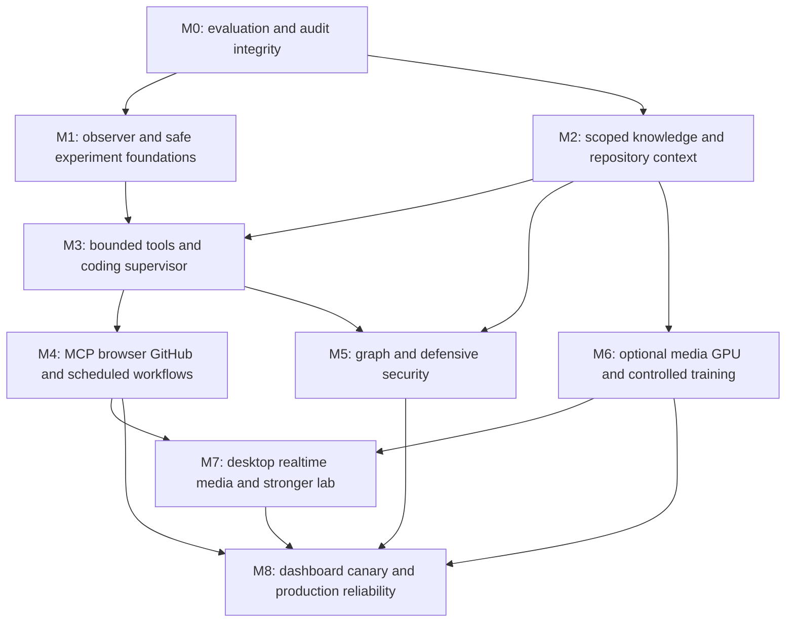

# Prioritized roadmap and implementation-ready tasks

The read-only audit and design are complete. This roadmap is proposed work, not
a statement that all forty capabilities have been implemented. Every milestone
ships small reviewable PRs with working code, tests, configuration documentation
and rollback. Missing backends remain unavailable instead of receiving placeholder
classes or a VERIFIED label from a mocked test.

## Dependency order

The per-capability prerequisite graph is in capabilities.json and is acyclic.
Milestones group related work; references to an existing component do not require
its entire future extension to finish before reuse. Specialists are admitted one
at a time as real backends pass, not all activated by a registry label.

| Milestone | Work and relevant capability IDs | Exit criteria / estimated complexity |
| --- | --- | --- |
| M0 | Versioned grading/uncertainty contracts (8), advisory coverage and branch publication requirements (24), reconcile status documentation | Known grading/coverage defects have regression tests; old results retained; no protected artifacts changed. Roughly 4–8 engineering days plus review. |
| M1 | Evolution read-only observer/discovery/proposals (7); scoped authority design; recovery (16); tested sandbox/workspace foundation (20) | Metadata-only proposals and rejection memory work across restart; no execution/deployment permission; schema application separately approved. Observer slice roughly 1–2 weeks, experiment foundations additional work. |
| M2 | Owner/project memory (3), lexical-first retrieval/context (4), repository index (18), text document parsing (32), evidence checks (2), routing/Ollama/hybrid metrics (5,35,37) | Actual data ingestion/retrieval/deletion and source-linked answers; zero tenant leakage; unchanged text defaults; live accounts/backends explicitly tested or blocked. Multiple L/M slices. |
| M3 | Task DAGs (10), collaboration/artifacts (15), supervisor and structured tool loop (9), terminal/development tools (13), coding loop/languages/architecture (17,19,22), reasoning plan integration (1) | Real local repository tasks complete inside verified isolation with bounded calls; safe restart/reconciliation; no silent commit/push or owner escalation. XL, incremental per language/specialist. |
| M4 | Isolated MCP (39), browser service (11), GitHub workflows (21), durable schedules/outbox (14), research specialist network evidence | Actual protocols/browser/repository/channel fixtures plus separately authorized external integrations; approval, egress, injection and duplicate-effect tests pass. Multiple L/XL slices. |
| M5 | Scoped graph (6), SOC/logs (23), vulnerability analysis (24), threat feeds (26), lab assessments (27), incident response (28), static malware inspection (25) | Labeled defensive/lab datasets measure utility and false positives; scope/authorization deny tests pass. Dynamic malware behavior remains blocked without stronger lab. |
| M6 | Optional vision/OCR (29), audio/TTS (30), image generation (33), GPU profiling/optimization (36), controlled training extensions (38) | Actual model/tool/accelerator evidence, licenses and resource budgets; CPU/text installation intact; quality/retention gates met before any deployment request. Hardware/access dependent XL program. |
| M7 | Desktop (12), real-time voice (31), video (34), optional dynamic malware VM lab (25) | Real supported OS/media/lab workflows, consent and sensitive-action controls; platform-specific unsupported items documented individually. External infrastructure dependent. |
| M8 | Existing dashboard extension (40), Evolution reviewed canary/rollback, readiness/backup/restore/soak/tracing and deployment hardening | Approved persistent host; measured availability/recovery/SLOs; current owner review, one-use approvals and tested rollback. No permanent-host claim from a transient workspace. |

This is a multi-month engineering program, with scope re-estimated after each
milestone. Complexity estimates are effort ranges, not commitments that all
features or proprietary-model-level quality can be delivered in a fixed number
of days. Public reference projects inform interfaces; their code/features are not
automatically reproduced by integration or a specialist prompt.

## First reviewable changes

1. **Version diagnostic graders without rewriting v1.** Extend quality.py with
   explicit scorer types and introduce suite-v2.json. Add tests separating exact
   byte JSON, semantic JSON, unit aliases, negative controls and evidence-qualified
   abstention. Retain the 11/14 and 2/3 raw v1 baseline and report paired v2 results
   separately. Do not claim newly trained intelligence from a grader correction.
2. **Make dependency-audit coverage explicit.** Update audit_dependencies.py and
   security workflow reporting to distinguish scanned, skipped and alternate
   vendor coverage. Add test_dependency_audit.py for the observed CPU Torch skip
   and zero-exit behavior. Expand workflow filters/jobs to each integration lock
   and native dependency environment without merging manifests or ignoring CVEs.
3. **Ship Evolution read-only preview.** New contracts/config/observer/discovery/
   proposals modules consume bounded existing metadata and frozen reports into
   validated local proposal artifacts. Default off; no DB migration, task execution,
   code/model writes, provider calls or deployment capability. Tests cover evidence
   thresholds, metric IDs reused after retention, privacy and deterministic output.
4. **Add approved Evolution persistence.** Component-owned additive migration,
   Store repository, idempotent event/proposal/rejection records and private
   owner/MFA read endpoints. Production migration requires a fingerprint-bound
   owner decision and tested backup. No experiment execution yet.
5. **Implement private lexical project retrieval.** Reuse reserved platform
   document tables only after scoped ingestion/search/deletion/expiry APIs and
   cross-account tests exist. Then admit the currently rejected memory flag.
   Keep shared public corpus behavior; embeddings remain optional future work.
6. **Add experiment isolation before autonomy.** Approved immutable workspace
   snapshots, structured test commands and artifact extraction through the existing
   sandbox policy. Actual Linux containment/restart tests first; no host fallback.
   Only then enable a bounded proposal-to-experiment path with explicit grants.

Each task can be reviewed independently. Changes that add protected policy,
capabilities, migrations or deployment rights must remain subject to the proposed
human approval gateway, even if earlier general development authorization exists.
New test subdirectories must be packages or have explicit CI discovery commands;
writing a test file that the existing unittest job never collects is not coverage.

## Twelve requested specialists

| Specialist | Actual handler to reuse/build | Remains unavailable until |
| --- | --- | --- |
| Reasoning | Existing ReasoningEngine + bounded task graph | New constraint/verification acceptance passes |
| Research | research_agent.py, research_fetch.py, source_verifier.py, citation_manager.py | Real retrieved sources support claims; approved network/SSRF and citation tests pass |
| Coding | coding_agent.py, patch_manager.py, test_runner.py | Actual isolated repository fix and hidden tests pass |
| Cybersecurity | security/ modules + existing ExecutionControls | Authorized scope and defensive lab/detection tests pass |
| Memory | project_memory.py, semantic_memory.py | Owner/project isolation and deletion/recall tests pass |
| Browser | browser_tools.py + independent browser service | Real navigation/form/download and injection tests pass |
| Computer control | desktop_tools.py + OS broker | Actual platform consent, target and sensitive-action tests pass |
| Automation | scheduler.py, outbox.py | Restart/idempotency and live authorization/delivery tests pass |
| Data analysis | data_analysis.py + approved sandbox/query adapter | Real data fixtures compute correct results with account-scoped artifact access; SQL is read-only and extensions/host access denied |
| Infrastructure | infrastructure_tools.py + explicit remote/container scopes | Read/status workflow and exact approved mutations pass on test-owned infrastructure |
| Evaluation | Existing quality/verification + Evolution evaluator | Frozen suite/scorer and intentional-failure gate tests pass |
| Model training | Existing continual/checkpoints/deployment + Evolution training adapter | Parent lineage, licensed data, retention and separate model approval pass |

Agents are software workflows around the existing model, not newly trained expert
networks. Accuracy limits of the preserved model remain measurable and explicit.
Provider routing, reference catalogs, native sidecars and weight training are
separate mechanisms; none alone proves weight-level intelligence improvement.

## Review and status tracking

Track each subsystem/backend/platform as NOT STARTED, PARTIAL, IMPLEMENTED,
VERIFIED or BLOCKED. VERIFIED requires the declared real-backend acceptance,
not just a mocked unit test. Keep risk/coverage/native provenance in each PR.
Before implementation, re-pin main, inspect the dependency owner and validate
disabled-state regression. Before merge, require current-head CI and resolved
review findings. Before publishing/deploying, require the exact approved candidate
and reversible release plan. Preserve failed experiments and blockers in the
Evolution ledger rather than silently omitting them.
