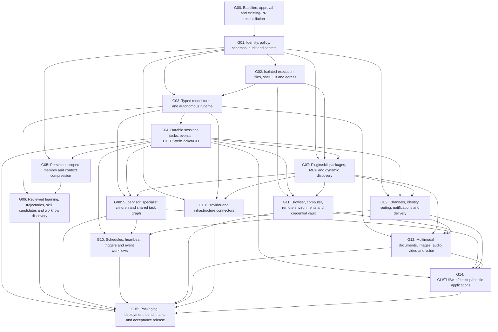

# Dependency graph

**Date:** 2026-10-25 UTC. **Scope:** audit/design only; further Zenith edits await approval of this expanded project.

OpenClaw `2f5727b9c61c2ba9dccc3c880d9115f02cb8652f`; Hermes `d05095663342556788cf2a198bfa7844cc7968ab`; Zenith main `e6963d9c6f45c196ae2e301819ae1ae093b35c41`; unmerged PR #19 `44d55d23cb946254a4a718a35a7c5432003cc01b`.

**Evidence:** S = source-verified code/declaration; D = upstream documentation/policy claim; M = actually measured; P = proposed; H = hypothesis. A manifest, tool schema, doc page or test filename does not prove successful execution. Status describes Zenith parity, not whether a reference project works.

| Order | Group | Prerequisites | Acceptance gate |
| --- | --- | --- | --- |
| 1 | G00 | Expanded audit approval | Verify pinned baseline/model/tokenizer hashes, PR19 divergence and rollback backup; no original checkpoint mutation. |
| 2 | G01 | G00 | Deny forged actors, stale MFA/grants, cross-account references and post-approval argument changes with zero side effects; preserve old DB writers. |
| 3 | G02 | G01 | Owned container/VM runs real bounded tools; reject forbidden file/network/process access, junction/symlink escapes and missing sandbox; no host fallback. |
| 4 | G03 | G01, G02 | Actual selected Zenith checkpoint completes frozen multi-step workflows with valid schemas, error recovery, budgets, attribution and cancellation; malformed calls have no effects. |
| 5 | G04 | G03 | Real HTTP/WS admission, replay, ownership, lease fencing and restart/cancel; uncertain non-idempotent writes reconcile instead of replay. |
| 6 | G05 | G01, G04 | Account/project recall, deletion/TTL, provenance, bounded context, compression checkpoint/recovery and retrieval relevance on frozen labels; no private/shared-corpus crossover. |
| 7 | G07 | G01, G02, G04 | Pinned manifest/schema/protocol negotiation, actual isolated invocation, tool/resource discovery, cancellation, auth/revocation and upgrade reapproval; malformed packages fail closed. |
| 8 | G06 | G03, G05 | Generate a real candidate from consented successful/failed traces, test on independent fixtures, review/activate/version/rollback; optional continued training preserves parent and retained quality. |
| 9 | G08 | G03, G04, G07 | Real supervisor/child goal completion, isolated workspaces, strict-subset grants, collective budgets, cancel/steer, blocked-input/review handoff and recovery. |
| 10 | G09 | G01, G04, G07 | Each separately inventoried service proves owned-account pairing, valid/invalid signatures, replay rejection, text/media/thread semantics and uncertain-send reconciliation; no test double counts as live service verification. |
| 11 | G11 | G02, G04, G07 | Actual isolated browser/VM/owned SSH endpoint, all-subresource egress checks, private-profile exclusion, approval-bound writes, cancellation and cleanup; missing backend is unavailable. |
| 12 | G13 | G01, G03, G07 | Exact account-visible model IDs, local-default/privacy routing, errors/failover and actual least-privilege owned API/database/host operations; unsupported/restricted models unavailable. |
| 13 | G10 | G04, G08, G09 | Durable UTC/cron+timezone jobs with tested DST/misfire/overlap policy, standing-authority expiry, event dedup and restart recovery. |
| 14 | G12 | G03, G07, G09, G11 | Real licensed compatible backends with bounded files, OCR/STT/TTS/vision/media fixtures and declared failure/unsupported formats; preserve text-only installation. |
| 15 | G14 | G04, G08, G09, G12 | Real target-OS builds, login/task/approval/reconnect/accessibility/media workflows and identity/model attribution; no native-client claim from Linux-only unit tests. |
| 16 | G15 | G04, G06, G08, G10, G11, G12, G13, G14 | Frozen paired reference/Zenith tests, security/retention/performance regressions, Windows/Linux CPU and optional GPU/remote/container/companion jobs, model-hash and rollback drills; publish only actual results. |

The graph is acyclic. Logical ordering does not require a monolithic release. Shared policy, actor identities, schemas and isolation must pass before any effectful tool. Gateways and adapters consume one engine and store. Channel-specific work may proceed independently after shared contracts pass; it cannot bypass their gates. Finish each small pull request with tests, documentation, evidence and rollback, then review before enabling it. No calendar estimate or guaranteed parity date is justified by the present audit.
