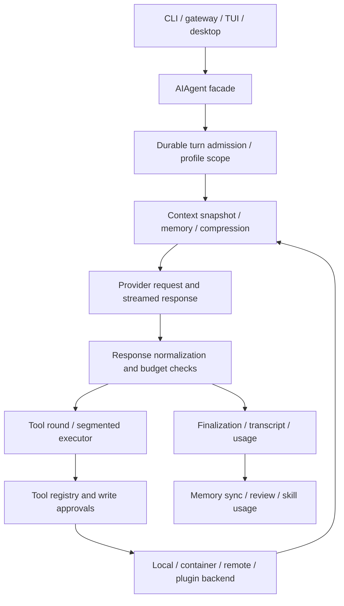

# Hermes Agent: source-level analysis

**Date:** 2026-10-25 UTC. **Scope:** audit/design only; further Zenith edits await approval of this expanded project.

OpenClaw `2f5727b9c61c2ba9dccc3c880d9115f02cb8652f`; Hermes `d05095663342556788cf2a198bfa7844cc7968ab`; Zenith main `e6963d9c6f45c196ae2e301819ae1ae093b35c41`; unmerged PR #19 `44d55d23cb946254a4a718a35a7c5432003cc01b`.

**Evidence:** S = source-verified code/declaration; D = upstream documentation/policy claim; M = actually measured; P = proposed; H = hypothesis. A manifest, tool schema, doc page or test filename does not prove successful execution. Status describes Zenith parity, not whether a reference project works.

## Scope, installation and declared platforms

The pinned Hermes tree has 21255 tracked files and 10208 Python modules, including a large test tree. Its package metadata reports version 0.0.0, so commit identity is more precise than inferring a published release version. Root dependencies declare Python >=3.11,<3.15 for updater compatibility while the managed runtime/lock uses 3.14; core dependency markers mostly require >=3.14. Desktop and root JS packages require Node >=26; the root npm engine excludes >=11.10.0,<11.17.0. Source: [pyproject.toml:1](https://github.com/NousResearch/hermes-agent/blob/d05095663342556788cf2a198bfa7844cc7968ab/pyproject.toml#L1), [pm/pyproject.toml:1](https://github.com/NousResearch/hermes-agent/blob/d05095663342556788cf2a198bfa7844cc7968ab/pm/pyproject.toml#L1), [pm/uv.lock:1](https://github.com/NousResearch/hermes-agent/blob/d05095663342556788cf2a198bfa7844cc7968ab/pm/uv.lock#L1), [package.json:1](https://github.com/NousResearch/hermes-agent/blob/d05095663342556788cf2a198bfa7844cc7968ab/package.json#L1), [apps/desktop/package.json:1](https://github.com/NousResearch/hermes-agent/blob/d05095663342556788cf2a198bfa7844cc7968ab/apps/desktop/package.json#L1).

D: Platform documentation prioritizes macOS Apple Silicon desktop, Windows CLI/MSIX, Linux/WSL2 CLI and Docker; Nix and Android/Termux aarch64 are best effort. Windows MSIX requires Windows 11 22H2+, some architectures/dependencies have limits, Intel macOS/Termux release builds are optional, and Linux desktop packaging is disabled in its release workflow despite local build paths. PyPI/brew/AUR installation is explicitly not a supported distribution method. These are upstream support policies, not host tests completed here: [website/docs/getting-started/platform-support.md:1](https://github.com/NousResearch/hermes-agent/blob/d05095663342556788cf2a198bfa7844cc7968ab/website/docs/getting-started/platform-support.md#L1).

P: Zenith retains its ordinary Python/venv installation and existing 3.10/3.12 support. Selected pure logic can be adapted with notices and compatibility tests; an isolated version-pinned worker may use another runtime when necessary. Do not install a second Hermes agent daemon or replace Zenith with `AIAgent`.

## Entry points, turn lifecycle and call graph

S: `run_agent.py` exposes `AIAgent` through multiple narrowly owned mixins. `TurnFacadeMixin.run_conversation` coordinates foreground/background admission, durable session leases, accounting/profile scopes and cleanup around `agent.conversation_loop.run_conversation`. Context/request/response/tool/finalization phases live in sibling modules. Sources: [run_agent.py:214](https://github.com/NousResearch/hermes-agent/blob/d05095663342556788cf2a198bfa7844cc7968ab/run_agent.py#L214), [agent/turn_facade.py:22](https://github.com/NousResearch/hermes-agent/blob/d05095663342556788cf2a198bfa7844cc7968ab/agent/turn_facade.py#L22), [agent/turn_facade_lease.py:1](https://github.com/NousResearch/hermes-agent/blob/d05095663342556788cf2a198bfa7844cc7968ab/agent/turn_facade_lease.py#L1), [agent/conversation_loop.py:1](https://github.com/NousResearch/hermes-agent/blob/d05095663342556788cf2a198bfa7844cc7968ab/agent/conversation_loop.py#L1), [agent/turn_context.py:1](https://github.com/NousResearch/hermes-agent/blob/d05095663342556788cf2a198bfa7844cc7968ab/agent/turn_context.py#L1), [agent/turn_request_assembly.py:1](https://github.com/NousResearch/hermes-agent/blob/d05095663342556788cf2a198bfa7844cc7968ab/agent/turn_request_assembly.py#L1), [agent/turn_response_intake.py:1](https://github.com/NousResearch/hermes-agent/blob/d05095663342556788cf2a198bfa7844cc7968ab/agent/turn_response_intake.py#L1), [agent/turn_tool_round.py:1](https://github.com/NousResearch/hermes-agent/blob/d05095663342556788cf2a198bfa7844cc7968ab/agent/turn_tool_round.py#L1), [agent/turn_finalizer.py:1](https://github.com/NousResearch/hermes-agent/blob/d05095663342556788cf2a198bfa7844cc7968ab/agent/turn_finalizer.py#L1).

The loop handles interruption/redirection, tool argument normalization, empty replies, provider failures, truncation and context pressure. These are source-level implemented paths; exact reliability/latency has not been measured here. Selected sources: [agent/turn_empty_response.py:1](https://github.com/NousResearch/hermes-agent/blob/d05095663342556788cf2a198bfa7844cc7968ab/agent/turn_empty_response.py#L1), [agent/turn_loop_errors.py:1](https://github.com/NousResearch/hermes-agent/blob/d05095663342556788cf2a198bfa7844cc7968ab/agent/turn_loop_errors.py#L1), [agent/turn_liveness.py:1](https://github.com/NousResearch/hermes-agent/blob/d05095663342556788cf2a198bfa7844cc7968ab/agent/turn_liveness.py#L1), [agent/interrupt_control.py:1](https://github.com/NousResearch/hermes-agent/blob/d05095663342556788cf2a198bfa7844cc7968ab/agent/interrupt_control.py#L1).

## Tool registry, discovery and parallel execution

S: Tools self-register schemas/handlers/check functions through `tools.registry`. `model_tools.py` imports built-in tool modules and discovers plugins, then serves tool definitions and dispatch. Toolsets separate core, coding, GUI and webhook-safe surfaces; service reachability checks do not themselves establish authorization. Table-driven definitions and per-session overlays mean a static schema count is not the runtime tool set for an account. Sources: [tools/registry.py:121](https://github.com/NousResearch/hermes-agent/blob/d05095663342556788cf2a198bfa7844cc7968ab/tools/registry.py#L121), [model_tools.py:1](https://github.com/NousResearch/hermes-agent/blob/d05095663342556788cf2a198bfa7844cc7968ab/model_tools.py#L1), [toolsets.py:11](https://github.com/NousResearch/hermes-agent/blob/d05095663342556788cf2a198bfa7844cc7968ab/toolsets.py#L11), [agent/tool_executor.py:1](https://github.com/NousResearch/hermes-agent/blob/d05095663342556788cf2a198bfa7844cc7968ab/agent/tool_executor.py#L1), [agent/terminal_approval_batch.py:1](https://github.com/NousResearch/hermes-agent/blob/d05095663342556788cf2a198bfa7844cc7968ab/agent/terminal_approval_batch.py#L1).

Native tools cover terminal/process control, file operations, web retrieval, browser/CDP/dialog/vault, vision/media, memory/session search, todos, skills, delegation, schedules, kanban and client-specific controls. The matrix tracks individual declarations/toolset members and service gates. Do not equate webhook-safe or default toolset names with capability grants in Zenith.

S: Terminal backends include local, Docker, SSH, Modal, managed Modal, Daytona and Vercel paths. Default configuration uses local host execution; some cloud backends require accounts/tokens and specific lifecycle controls. Docker egress and local subprocess-environment policies are separate. File tools use the backend shell contract. Sources: [hermes_cli/config_defaults.py:298](https://github.com/NousResearch/hermes-agent/blob/d05095663342556788cf2a198bfa7844cc7968ab/hermes_cli/config_defaults.py#L298), [tools/terminal_tool_backends.py:1](https://github.com/NousResearch/hermes-agent/blob/d05095663342556788cf2a198bfa7844cc7968ab/tools/terminal_tool_backends.py#L1), [tools/environments/local.py:1](https://github.com/NousResearch/hermes-agent/blob/d05095663342556788cf2a198bfa7844cc7968ab/tools/environments/local.py#L1), [tools/environments/local_env_policy.py:1](https://github.com/NousResearch/hermes-agent/blob/d05095663342556788cf2a198bfa7844cc7968ab/tools/environments/local_env_policy.py#L1), [tools/environments/docker.py:1](https://github.com/NousResearch/hermes-agent/blob/d05095663342556788cf2a198bfa7844cc7968ab/tools/environments/docker.py#L1), [tools/environments/docker_egress.py:1](https://github.com/NousResearch/hermes-agent/blob/d05095663342556788cf2a198bfa7844cc7968ab/tools/environments/docker_egress.py#L1), [tools/environments/ssh.py:1](https://github.com/NousResearch/hermes-agent/blob/d05095663342556788cf2a198bfa7844cc7968ab/tools/environments/ssh.py#L1), [tools/file_operations.py:1](https://github.com/NousResearch/hermes-agent/blob/d05095663342556788cf2a198bfa7844cc7968ab/tools/file_operations.py#L1).

S/D: Hermes's security policy is explicitly single-tenant and treats OS isolation as the boundary against an adversarial model. A container terminal does not isolate in-process plugin/hooks, MCP subprocesses or every execution path. This is an architectural trust assumption, not a vulnerability finding or an escape test. Zenith must put untrusted executable effects behind its own least-privilege broker and isolated workers: [SECURITY.md:32](https://github.com/NousResearch/hermes-agent/blob/d05095663342556788cf2a198bfa7844cc7968ab/SECURITY.md#L32), [tools/code_execution_tool.py:1](https://github.com/NousResearch/hermes-agent/blob/d05095663342556788cf2a198bfa7844cc7968ab/tools/code_execution_tool.py#L1).

## State and memory are separate learning layers

S: `hermes_state.py` is a SQLite/WAL facade over schema/session/message/search/compression/maintenance owners. It stores source-tagged sessions and lineage; batch/RL trajectories are separate. Built-in curated memory is bounded file-backed MEMORY.md / USER.md, with locking, validation and backup/drift safeguards. It is not a built-in universal vector database or a neural weight update. Sources: [hermes_state.py:1](https://github.com/NousResearch/hermes-agent/blob/d05095663342556788cf2a198bfa7844cc7968ab/hermes_state.py#L1), [hermes_state_schema.py:1](https://github.com/NousResearch/hermes-agent/blob/d05095663342556788cf2a198bfa7844cc7968ab/hermes_state_schema.py#L1), [hermes_state_search.py:1](https://github.com/NousResearch/hermes-agent/blob/d05095663342556788cf2a198bfa7844cc7968ab/hermes_state_search.py#L1), [tools/memory_tool_store.py:1](https://github.com/NousResearch/hermes-agent/blob/d05095663342556788cf2a198bfa7844cc7968ab/tools/memory_tool_store.py#L1).

S: `MemoryManager` fans lifecycle/prefetch/sync/tool hooks to the built-in provider plus at most one external plugin provider. It binds caller/profile context across workers, scrubs egress and bounds stuck/inflight calls. Provider checkpoint API v2 supports strict pre-compression handoffs. Sources: [agent/memory_manager.py:1](https://github.com/NousResearch/hermes-agent/blob/d05095663342556788cf2a198bfa7844cc7968ab/agent/memory_manager.py#L1), [agent/memory_provider.py:37](https://github.com/NousResearch/hermes-agent/blob/d05095663342556788cf2a198bfa7844cc7968ab/agent/memory_provider.py#L37), [agent/memory_caller_scope.py:1](https://github.com/NousResearch/hermes-agent/blob/d05095663342556788cf2a198bfa7844cc7968ab/agent/memory_caller_scope.py#L1), [agent/conversation_compression_checkpoint.py:1](https://github.com/NousResearch/hermes-agent/blob/d05095663342556788cf2a198bfa7844cc7968ab/agent/conversation_compression_checkpoint.py#L1).

D/S: The two in-tree external memory plugins are RetainDB and ByteRover; additional advertised systems such as Honcho, Mem0, OpenViking, Hindsight, Holographic and Supermemory are catalog integrations outside this tree. They may require external repositories, SDKs, cloud/self-hosted services and permission to export conversation data. Source: [website/docs/user-guide/features/memory-providers.md:1](https://github.com/NousResearch/hermes-agent/blob/d05095663342556788cf2a198bfa7844cc7968ab/website/docs/user-guide/features/memory-providers.md#L1), [plugins/memory/retaindb/plugin.yaml:1](https://github.com/NousResearch/hermes-agent/blob/d05095663342556788cf2a198bfa7844cc7968ab/plugins/memory/retaindb/plugin.yaml#L1), [plugins/memory/byterover/plugin.yaml:1](https://github.com/NousResearch/hermes-agent/blob/d05095663342556788cf2a198bfa7844cc7968ab/plugins/memory/byterover/plugin.yaml#L1). The catalog references are tracked separately as blocked, not claimed source-inspected implementations.

S: Context compression has checkpoint, archive, summary, tail, retry and timeout owners. Prompt/system/tool surfaces are restored/pinned per conversation where supported; skills/config updates may be deferred rather than mutating cached prefixes. Source: [agent/context_compressor.py:1](https://github.com/NousResearch/hermes-agent/blob/d05095663342556788cf2a198bfa7844cc7968ab/agent/context_compressor.py#L1), [agent/conversation_compression.py:1](https://github.com/NousResearch/hermes-agent/blob/d05095663342556788cf2a198bfa7844cc7968ab/agent/conversation_compression.py#L1), [agent/prompt_cache_scope.py:1](https://github.com/NousResearch/hermes-agent/blob/d05095663342556788cf2a198bfa7844cc7968ab/agent/prompt_cache_scope.py#L1), [agent/conversation_loop.py:818](https://github.com/NousResearch/hermes-agent/blob/d05095663342556788cf2a198bfa7844cc7968ab/agent/conversation_loop.py#L818).

P: Reuse Zenith's current SQLite, notes, summaries and ownership. Add scoped derived semantic/episodic/search records, preserve old shared-corpus semantics, and explicitly version context snapshots. Model context compression must not silently delete user history, lose tool-call/result pairs, cross accounts or present summaries as verified truth.

## Skill learning, versioning and curator

S: `skill_manage` supports create/edit/patch/delete/supporting-file operations, bounded content/frontmatter, mutation locks, provenance, usage and ledgered changes. Hub paths, optional/bundled sync, scanning and AST inspection are distinct owners. Sources: [tools/skill_manager_tool.py:783](https://github.com/NousResearch/hermes-agent/blob/d05095663342556788cf2a198bfa7844cc7968ab/tools/skill_manager_tool.py#L783), [tools/skill_manager_guards.py:1](https://github.com/NousResearch/hermes-agent/blob/d05095663342556788cf2a198bfa7844cc7968ab/tools/skill_manager_guards.py#L1), [tools/skill_usage.py:1](https://github.com/NousResearch/hermes-agent/blob/d05095663342556788cf2a198bfa7844cc7968ab/tools/skill_usage.py#L1), [tools/skill_ledger.py:1](https://github.com/NousResearch/hermes-agent/blob/d05095663342556788cf2a198bfa7844cc7968ab/tools/skill_ledger.py#L1), [tools/skill_provenance.py:1](https://github.com/NousResearch/hermes-agent/blob/d05095663342556788cf2a198bfa7844cc7968ab/tools/skill_provenance.py#L1), [tools/skills_hub_install.py:1](https://github.com/NousResearch/hermes-agent/blob/d05095663342556788cf2a198bfa7844cc7968ab/tools/skills_hub_install.py#L1), [tools/skills_guard.py:1](https://github.com/NousResearch/hermes-agent/blob/d05095663342556788cf2a198bfa7844cc7968ab/tools/skills_guard.py#L1).

S: Skill write approval can stage writes, bind origin and replay approved payloads. The skill-manager helper explicitly fails open when its write-approval import is unavailable; agent-created skill security scanning is opt-in by default. These source choices must not be mistaken for mandatory isolation/review of all generated code. No exploit has been attempted. Sources: [tools/skill_manager_tool.py:672](https://github.com/NousResearch/hermes-agent/blob/d05095663342556788cf2a198bfa7844cc7968ab/tools/skill_manager_tool.py#L672), [tools/skill_manager_tool.py:41](https://github.com/NousResearch/hermes-agent/blob/d05095663342556788cf2a198bfa7844cc7968ab/tools/skill_manager_tool.py#L41), [tools/write_approval.py:1](https://github.com/NousResearch/hermes-agent/blob/d05095663342556788cf2a198bfa7844cc7968ab/tools/write_approval.py#L1).

S: Curator is enabled by default for deterministic lifecycle transitions; model-based consolidation is separately **off by default**. Reviews can snapshot skills and run a skills-only AIAgent fork with mutation provenance/guards and reports. Its ledger/backup safeguards are useful, but are not held-out task evaluation or evidence that the foundation model acquired new weights. Sources: [agent/curator.py:106](https://github.com/NousResearch/hermes-agent/blob/d05095663342556788cf2a198bfa7844cc7968ab/agent/curator.py#L106), [agent/curator.py:915](https://github.com/NousResearch/hermes-agent/blob/d05095663342556788cf2a198bfa7844cc7968ab/agent/curator.py#L915), [agent/curator_backup.py:1](https://github.com/NousResearch/hermes-agent/blob/d05095663342556788cf2a198bfa7844cc7968ab/agent/curator_backup.py#L1).

P: Zenith uses candidate → isolated behavioral tests → reviewed activation → version/rollback. All skill/code mutation stays inactive until review. Training trajectories carry consent/license/provenance and exclude secrets, held-out fixtures and provider output without permitted training rights. Optional neural continuation calls Zenith's existing CPT/SFT/DPO/checkpoint/deployment owners, never random initialization or automatic promotion.

## Multi-agent and durable automation

S: Delegation supports leaf/orchestrator roles, fresh child contexts, task/workspace identity, bounded concurrency/depth/time, filtered toolsets and control/progress/results. Source: [tools/delegate_tool.py:1](https://github.com/NousResearch/hermes-agent/blob/d05095663342556788cf2a198bfa7844cc7968ab/tools/delegate_tool.py#L1), [tools/delegate_tool_config.py:1](https://github.com/NousResearch/hermes-agent/blob/d05095663342556788cf2a198bfa7844cc7968ab/tools/delegate_tool_config.py#L1), [tools/delegate_tool_child_run.py:1](https://github.com/NousResearch/hermes-agent/blob/d05095663342556788cf2a198bfa7844cc7968ab/tools/delegate_tool_child_run.py#L1), [tools/delegate_tool_toolsets.py:1](https://github.com/NousResearch/hermes-agent/blob/d05095663342556788cf2a198bfa7844cc7968ab/tools/delegate_tool_toolsets.py#L1), [tools/async_delegation.py:1](https://github.com/NousResearch/hermes-agent/blob/d05095663342556788cf2a198bfa7844cc7968ab/tools/async_delegation.py#L1), [tools/delegate_tool_registry.py:1](https://github.com/NousResearch/hermes-agent/blob/d05095663342556788cf2a198bfa7844cc7968ab/tools/delegate_tool_registry.py#L1).

S: Kanban provides task coordination/review/heartbeat/block/attachments and dispatcher state, while mixture-of-agents coordinates model responses separately. Neither is evidence of weight merging. Sources: [tools/kanban_tools.py:1](https://github.com/NousResearch/hermes-agent/blob/d05095663342556788cf2a198bfa7844cc7968ab/tools/kanban_tools.py#L1), [hermes_cli/kanban.py:1](https://github.com/NousResearch/hermes-agent/blob/d05095663342556788cf2a198bfa7844cc7968ab/hermes_cli/kanban.py#L1), [agent/moa_loop.py:1](https://github.com/NousResearch/hermes-agent/blob/d05095663342556788cf2a198bfa7844cc7968ab/agent/moa_loop.py#L1), [agent/moa_trace.py:1](https://github.com/NousResearch/hermes-agent/blob/d05095663342556788cf2a198bfa7844cc7968ab/agent/moa_trace.py#L1).

S: Hermes cron stores jobs in **JSON** under the profile cron directory with locks, claims, schedule/timezone handling and output/delivery paths. This differs from the audited OpenClaw SQLite scheduler. Sources: [cron/jobs.py:1](https://github.com/NousResearch/hermes-agent/blob/d05095663342556788cf2a198bfa7844cc7968ab/cron/jobs.py#L1), [cron/scheduler.py:1](https://github.com/NousResearch/hermes-agent/blob/d05095663342556788cf2a198bfa7844cc7968ab/cron/scheduler.py#L1). P: a unified Zenith scheduler should reuse its SQLite transactional owner, not install a second jobs.json scheduler and state database.

## Gateway, channels, MCP, interfaces and media

S: GatewayRunner handles configured adapters, session/runtime caches, platform lifecycle, dispatch and profile binding. Platform registration separates passive dependency probes from active dependency preparation; status displays are not supposed to install services. PlatformEntry carries sender/account policies, target resolution, streaming/media and delivery metadata. Sources: [gateway/run.py:1](https://github.com/NousResearch/hermes-agent/blob/d05095663342556788cf2a198bfa7844cc7968ab/gateway/run.py#L1), [gateway/platform_registry.py:43](https://github.com/NousResearch/hermes-agent/blob/d05095663342556788cf2a198bfa7844cc7968ab/gateway/platform_registry.py#L43), [gateway/run_adapters.py:1](https://github.com/NousResearch/hermes-agent/blob/d05095663342556788cf2a198bfa7844cc7968ab/gateway/run_adapters.py#L1).

The matrix separately records all 27 platform manifests, concrete registration variants (including WeCom callback and relay), source-backed tool/GUI/provider plugins and catalog entries. A platform manifest's existence is not proof of an owned account or device test. Telegram, Slack, Discord, WhatsApp modes, Matrix, Teams, Feishu, WeCom/Weixin and other adapters must each retain their own authentication, media/thread and delivery acceptance profile.

S: MCP owners cover stdio, SSE and streamable HTTP, OAuth/device flows, connection identity, schema caching, scope/trust metadata, bounded transport and dispatch. MCP descriptions/results remain external data. Source: [tools/mcp_tool_transport.py:1](https://github.com/NousResearch/hermes-agent/blob/d05095663342556788cf2a198bfa7844cc7968ab/tools/mcp_tool_transport.py#L1), [tools/mcp_tool_registration.py:1](https://github.com/NousResearch/hermes-agent/blob/d05095663342556788cf2a198bfa7844cc7968ab/tools/mcp_tool_registration.py#L1), [tools/mcp_oauth.py:1](https://github.com/NousResearch/hermes-agent/blob/d05095663342556788cf2a198bfa7844cc7968ab/tools/mcp_oauth.py#L1), [tools/mcp_schema_cache.py:1](https://github.com/NousResearch/hermes-agent/blob/d05095663342556788cf2a198bfa7844cc7968ab/tools/mcp_schema_cache.py#L1).

S: The CLI, Ink TUI + Python JSON-RPC backend, web SPA and Electron desktop are distinct surfaces on the agent engine. Browser/CDP and vault are distinct from computer input/capture; voice/STT/TTS/video/image handling require compatible backends. Sources: [cli.py:1](https://github.com/NousResearch/hermes-agent/blob/d05095663342556788cf2a198bfa7844cc7968ab/cli.py#L1), [ui-tui/package.json:1](https://github.com/NousResearch/hermes-agent/blob/d05095663342556788cf2a198bfa7844cc7968ab/ui-tui/package.json#L1), [tui_gateway/server.py:1](https://github.com/NousResearch/hermes-agent/blob/d05095663342556788cf2a198bfa7844cc7968ab/tui_gateway/server.py#L1), [web/package.json:1](https://github.com/NousResearch/hermes-agent/blob/d05095663342556788cf2a198bfa7844cc7968ab/web/package.json#L1), [apps/desktop/package.json:1](https://github.com/NousResearch/hermes-agent/blob/d05095663342556788cf2a198bfa7844cc7968ab/apps/desktop/package.json#L1), [tools/browser_use_cli.py:1](https://github.com/NousResearch/hermes-agent/blob/d05095663342556788cf2a198bfa7844cc7968ab/tools/browser_use_cli.py#L1), [tools/browser_vault_tool.py:1](https://github.com/NousResearch/hermes-agent/blob/d05095663342556788cf2a198bfa7844cc7968ab/tools/browser_vault_tool.py#L1), [tools/computer_use/tool.py:1](https://github.com/NousResearch/hermes-agent/blob/d05095663342556788cf2a198bfa7844cc7968ab/tools/computer_use/tool.py#L1), [tools/voice_mode.py:1](https://github.com/NousResearch/hermes-agent/blob/d05095663342556788cf2a198bfa7844cc7968ab/tools/voice_mode.py#L1), [tools/vision_tools.py:1](https://github.com/NousResearch/hermes-agent/blob/d05095663342556788cf2a198bfa7844cc7968ab/tools/vision_tools.py#L1).

## What the audit does not establish

No Hermes dependency manager, plugin, tool, application, test runner or external service was executed. No comparison validates the README's exclusivity claim about being the only self-improving agent, nor its broad cost/latency marketing statements. No proprietary model's weights or hidden reasoning are accessed. The project is useful source for agent infrastructure; importing/rebranding it does not meet the mission's requirement that Zenith remain the model and primary unified engine.
