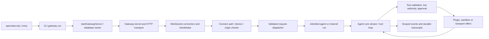

# OpenClaw pinned-source analysis for the unified audit

The detailed analysis below is reused from the same immutable source snapshot. Its Zenith main pin is still current. The later unmerged PR19 pilot and Hermes comparison are covered separately in this package. No claim is made that this pin includes later upstream commits or that OpenClaw was executed.

# OpenClaw source-level engineering audit

**Audit date:** 2026-10-25 UTC. **OpenClaw:** `2f5727b9c61c2ba9dccc3c880d9115f02cb8652f`. **Zenith main:** `e6963d9c6f45c196ae2e301819ae1ae093b35c41`. This is an audit/design deliverable; no Zenith implementation changes are authorized in this delivery.

**Evidence labels:** S = source-verified at the pinned commit; M = measured here; D = upstream documentation/policy claim; P = proposed design; H = hypothesis requiring implementation or experiment. Source inspection does not establish successful live execution.

## Scope, provenance and limits

Both repositories were cloned separately. OpenClaw main moved between the API metadata request and clone; this report uses the actual clone commit above, detached and fixed, rather than the earlier API observation. The read-only inventory hashes all **59,647 tracked files** and records script imports/export anchors in `../evidence/openclaw-source-index.jsonl`. It includes source, tests, generated files, fixtures, native applications and assets. The inventory is whole-tree coverage, not a claim of human line-by-line review of every file. Manual semantic review follows the critical gateway/runtime/tool/memory/plugin/channel/scheduler/security/UI paths below. Dynamic dispatch and generated/native transitive behavior have not all been executed or formally resolved.

S: Package version is `2026.10.7`, ESM, with `openclaw.mjs` as the binary and `dist/index.js` as the main export; required Node is `>=24.22.1 <25 || >=26.12.1`, package manager is pnpm `12.15.0`. The audit host has Node **24.19.0**, below that requirement. No dependency installation, lifecycle script, OpenClaw gateway, browser, channel or upstream test suite was run. Consequently this report claims source-verified architectural support, not tested OpenClaw task success, plugin safety, performance or sandbox resistance. Source: [package.json:2517](https://github.com/openclaw/openclaw/blob/2f5727b9c61c2ba9dccc3c880d9115f02cb8652f/package.json#L2517).

## Entry points and gateway call graph

S: The CLI wrapper and TypeScript entry perform runtime/profile/bootstrap handling, then CLI dispatch. The gateway fast path loads Commander and the run-command adapter. The command ultimately starts the gateway facade, which initializes database admission/ownership before importing the full server. The server constructs its kernel, HTTP transport and startup services. Evidence: [openclaw.mjs:1](https://github.com/openclaw/openclaw/blob/2f5727b9c61c2ba9dccc3c880d9115f02cb8652f/openclaw.mjs#L1); [src/entry.ts:133](https://github.com/openclaw/openclaw/blob/2f5727b9c61c2ba9dccc3c880d9115f02cb8652f/src/entry.ts#L133); [src/cli/run-main.ts:103](https://github.com/openclaw/openclaw/blob/2f5727b9c61c2ba9dccc3c880d9115f02cb8652f/src/cli/run-main.ts#L103); [src/cli/gateway-cli/run.ts:926](https://github.com/openclaw/openclaw/blob/2f5727b9c61c2ba9dccc3c880d9115f02cb8652f/src/cli/gateway-cli/run.ts#L926); [src/gateway/server.ts:25](https://github.com/openclaw/openclaw/blob/2f5727b9c61c2ba9dccc3c880d9115f02cb8652f/src/gateway/server.ts#L25); [src/gateway/server-start.ts:19](https://github.com/openclaw/openclaw/blob/2f5727b9c61c2ba9dccc3c880d9115f02cb8652f/src/gateway/server-start.ts#L19).

S: HTTP server construction and WebSocket handlers are separate adapters. The message handler imports `validateConnectParams`, `validateRequestFrame`, connect authentication, device authorization and authenticated dispatch. Connect schema includes protocol ranges, client/capability declarations, role/scopes, device signature/nonce fields and auth fields. This is OpenClaw's own versioned WebSocket/RPC contract; it must not be mistaken for MCP or a drop-in Zenith protocol. Sources: [src/gateway/server-http.ts:17](https://github.com/openclaw/openclaw/blob/2f5727b9c61c2ba9dccc3c880d9115f02cb8652f/src/gateway/server-http.ts#L17); [src/gateway/server/ws-connection.ts:44](https://github.com/openclaw/openclaw/blob/2f5727b9c61c2ba9dccc3c880d9115f02cb8652f/src/gateway/server/ws-connection.ts#L44); [src/gateway/server/ws-connection/message-handler.ts:87](https://github.com/openclaw/openclaw/blob/2f5727b9c61c2ba9dccc3c880d9115f02cb8652f/src/gateway/server/ws-connection/message-handler.ts#L87); [packages/gateway-protocol/src/schema/frames.ts:34](https://github.com/openclaw/openclaw/blob/2f5727b9c61c2ba9dccc3c880d9115f02cb8652f/packages/gateway-protocol/src/schema/frames.ts#L34); [src/gateway/server-methods.ts:263](https://github.com/openclaw/openclaw/blob/2f5727b9c61c2ba9dccc3c880d9115f02cb8652f/src/gateway/server-methods.ts#L263).

Observed lifecycle boundaries: wrapper/runtime preflight → gateway ownership/database admission → kernel creation → transport attach → deferred post-ready startup → accepting authenticated requests → draining/close and ownership release. Failure startup calls cleanup; `close()` is joined rather than releasing ownership over live work. Request dispatch carries cancellation and current authority; exact ownership/profile state matters after asynchronous preparation. These are traced code paths, not crash-recovery tests performed here.

## Configuration schema and mutation path

S: `config/config.ts` and `config/io.ts` are public facades. `createConfigIO` owns a shared context and routes load/snapshot/recovery operations to separate modules; writes acquire a config write lock before the write engine. Raw/source/runtime snapshots are distinct. Read helpers parse JSON5, resolve guarded includes and environment substitution and hash raw/include revisions. The runtime module exposes prepared snapshots and policy-current reads; the synchronous `loadConfig` export is marked deprecated in favor of prepared/async readers. Sources: [src/config/config.ts:1](https://github.com/openclaw/openclaw/blob/2f5727b9c61c2ba9dccc3c880d9115f02cb8652f/src/config/config.ts#L1); [src/config/io.factory.ts:24](https://github.com/openclaw/openclaw/blob/2f5727b9c61c2ba9dccc3c880d9115f02cb8652f/src/config/io.factory.ts#L24); [src/config/io.read-helpers.ts:1](https://github.com/openclaw/openclaw/blob/2f5727b9c61c2ba9dccc3c880d9115f02cb8652f/src/config/io.read-helpers.ts#L1); [src/config/io.runtime.ts:99](https://github.com/openclaw/openclaw/blob/2f5727b9c61c2ba9dccc3c880d9115f02cb8652f/src/config/io.runtime.ts#L99).

S: `OpenClawSchema` is a strict Zod object composed from root-shape schemas for models, agents, gateway, channels, tools, database, approvals, secrets, security, memory and related domains. Cross-field refinements validate agent references/bindings. Plugin-aware validation prepares migrated/defaulted facts separately from async metadata loading and clones state across await boundaries; it has core-only and stricter validation modes. The write engine validates candidates and reasserts base snapshot currency; mutation helpers compare expected paths/base hashes and serialize writer operations. Sources: [src/config/zod-schema.ts:7](https://github.com/openclaw/openclaw/blob/2f5727b9c61c2ba9dccc3c880d9115f02cb8652f/src/config/zod-schema.ts#L7); [src/config/zod-schema.root-shape.ts:41](https://github.com/openclaw/openclaw/blob/2f5727b9c61c2ba9dccc3c880d9115f02cb8652f/src/config/zod-schema.root-shape.ts#L41); [src/config/validation.ts:44](https://github.com/openclaw/openclaw/blob/2f5727b9c61c2ba9dccc3c880d9115f02cb8652f/src/config/validation.ts#L44); [src/config/io.write.ts:117](https://github.com/openclaw/openclaw/blob/2f5727b9c61c2ba9dccc3c880d9115f02cb8652f/src/config/io.write.ts#L117); [src/config/mutate.ts:179](https://github.com/openclaw/openclaw/blob/2f5727b9c61c2ba9dccc3c880d9115f02cb8652f/src/config/mutate.ts#L179).

Trace: authored config + guarded include/environment facts → core schema → plugin metadata validation → source/runtime snapshot → current-policy reader. Mutation follows locked source snapshot → expected path/hash check → validated candidate → write/recovery bookkeeping → runtime refresh notification. This is a source trace, not an exercised recovery guarantee. P: Zenith should retain its own existing env/Settings public contract and use versioned opt-in Python settings plus DB migrations, not adopt OpenClaw's JSON5 layout or migrate user configuration implicitly.

## Agent runtime and tools

S: `Agent.prompt()` / continuation enter `runAgentLoop`; the loop streams assistant messages, detects tool calls, validates/adopts tool batches, executes groups, appends results, and can continue until a terminal response or interruption. Tool preparation and launch are distinct. Sequential/parallel groups, cancellation, steering and result events are explicitly represented. Sources: [packages/agent-core/src/agent.ts:158](https://github.com/openclaw/openclaw/blob/2f5727b9c61c2ba9dccc3c880d9115f02cb8652f/packages/agent-core/src/agent.ts#L158); [packages/agent-core/src/agent-loop.ts:86](https://github.com/openclaw/openclaw/blob/2f5727b9c61c2ba9dccc3c880d9115f02cb8652f/packages/agent-core/src/agent-loop.ts#L86); [packages/agent-core/src/agent-loop.ts:483](https://github.com/openclaw/openclaw/blob/2f5727b9c61c2ba9dccc3c880d9115f02cb8652f/packages/agent-core/src/agent-loop.ts#L483); [packages/agent-core/src/agent-loop-tool-execution.ts:45](https://github.com/openclaw/openclaw/blob/2f5727b9c61c2ba9dccc3c880d9115f02cb8652f/packages/agent-core/src/agent-loop-tool-execution.ts#L45); [packages/agent-core/src/agent-loop-tool-execution.ts:305](https://github.com/openclaw/openclaw/blob/2f5727b9c61c2ba9dccc3c880d9115f02cb8652f/packages/agent-core/src/agent-loop-tool-execution.ts#L305).

S: Host tool assembly composes inherited tool policies, runtime/sandbox context and wrappers; availability declarations are distinct from permission to execute. The turn-authority surface can keep stable tool definitions while substituting a denial executor. Hook-driven argument changes and approvals have producer-owned preparation/finalization paths. Admitted run contexts retain current operator/source assertions. These patterns are valuable for Zenith's stable prompt context and server-side execution gate. Sources: [src/agents/agent-tools.ts:1](https://github.com/openclaw/openclaw/blob/2f5727b9c61c2ba9dccc3c880d9115f02cb8652f/src/agents/agent-tools.ts#L1); [src/agents/agent-tools.turn-authority.ts:34](https://github.com/openclaw/openclaw/blob/2f5727b9c61c2ba9dccc3c880d9115f02cb8652f/src/agents/agent-tools.turn-authority.ts#L34); [src/agents/agent-tool-availability.ts:70](https://github.com/openclaw/openclaw/blob/2f5727b9c61c2ba9dccc3c880d9115f02cb8652f/src/agents/agent-tool-availability.ts#L70); [src/agents/agent-tools.before-tool-call.wrapper.ts:1](https://github.com/openclaw/openclaw/blob/2f5727b9c61c2ba9dccc3c880d9115f02cb8652f/src/agents/agent-tools.before-tool-call.wrapper.ts#L1); [src/agents/admitted-run-context.ts:93](https://github.com/openclaw/openclaw/blob/2f5727b9c61c2ba9dccc3c880d9115f02cb8652f/src/agents/admitted-run-context.ts#L93).

S: Subagent spawn and registry are separate owners with context/sandbox inheritance, admitted authority and lifecycle/recovery helpers. This is more than querying two models. Sources: [src/agents/subagents/spawn/subagent-spawn.ts:69](https://github.com/openclaw/openclaw/blob/2f5727b9c61c2ba9dccc3c880d9115f02cb8652f/src/agents/subagents/spawn/subagent-spawn.ts#L69); [src/agents/subagents/registry/subagent-registry.ts:188](https://github.com/openclaw/openclaw/blob/2f5727b9c61c2ba9dccc3c880d9115f02cb8652f/src/agents/subagents/registry/subagent-registry.ts#L188).

## Memory and persistence

S: In this commit, the substantial memory engine is under **`extensions/memory-core`**, not an assumed monolithic `src/memory/manager.ts`. The manager acquires per-agent/workspace/provider/purpose identities and opens admitted database state; search orchestration supports lexical-only and embedding-provider paths, degraded/fallback lifecycle and cancellation. Hybrid ranking merges vector/text signals and can apply MMR, temporal decay and project factors. Sources: [extensions/memory-core/index.ts:1](https://github.com/openclaw/openclaw/blob/2f5727b9c61c2ba9dccc3c880d9115f02cb8652f/extensions/memory-core/index.ts#L1); [extensions/memory-core/src/memory/manager.ts:55](https://github.com/openclaw/openclaw/blob/2f5727b9c61c2ba9dccc3c880d9115f02cb8652f/extensions/memory-core/src/memory/manager.ts#L55); [extensions/memory-core/src/memory/manager-search-orchestration.ts:1](https://github.com/openclaw/openclaw/blob/2f5727b9c61c2ba9dccc3c880d9115f02cb8652f/extensions/memory-core/src/memory/manager-search-orchestration.ts#L1); [extensions/memory-core/src/memory/hybrid.ts:59](https://github.com/openclaw/openclaw/blob/2f5727b9c61c2ba9dccc3c880d9115f02cb8652f/extensions/memory-core/src/memory/hybrid.ts#L59); [extensions/memory-core/src/memory/embeddings.ts:1](https://github.com/openclaw/openclaw/blob/2f5727b9c61c2ba9dccc3c880d9115f02cb8652f/extensions/memory-core/src/memory/embeddings.ts#L1).

The runtime distinguishes durable agent/state database ownership, worker-mediated access, derived indexes and process-local caches. Root package metadata advertises SQLite and PostgreSQL database families and schema versions; this report does not assert complete interchangeable behavior for every plugin/backend. A separate LanceDB plugin exists but is optional and is not evidence that all memory is stored in LanceDB. Sources: [package.json:6](https://github.com/openclaw/openclaw/blob/2f5727b9c61c2ba9dccc3c880d9115f02cb8652f/package.json#L6); [src/state/openclaw-state-db-admission.ts:1](https://github.com/openclaw/openclaw/blob/2f5727b9c61c2ba9dccc3c880d9115f02cb8652f/src/state/openclaw-state-db-admission.ts#L1); [extensions/memory-lancedb/lancedb-store.ts:1](https://github.com/openclaw/openclaw/blob/2f5727b9c61c2ba9dccc3c880d9115f02cb8652f/extensions/memory-lancedb/lancedb-store.ts#L1).

## Plugins, skills and models

S: Discovery/manifest/control metadata and runtime module loading are separate. `openclaw.plugin.json` carries contracts, config schemas, activation and platform/UI metadata. Registry handles can be inspected without process-wide activation; module-loading paths execute Node-compatible plugin modules. Manifest validation is not a proof that arbitrary plugin code is safe. Sources: [src/plugins/discovery.ts:1107](https://github.com/openclaw/openclaw/blob/2f5727b9c61c2ba9dccc3c880d9115f02cb8652f/src/plugins/discovery.ts#L1107); [src/plugins/manifest.ts:1](https://github.com/openclaw/openclaw/blob/2f5727b9c61c2ba9dccc3c880d9115f02cb8652f/src/plugins/manifest.ts#L1); [src/plugins/loader.ts:18](https://github.com/openclaw/openclaw/blob/2f5727b9c61c2ba9dccc3c880d9115f02cb8652f/src/plugins/loader.ts#L18); [src/plugins/loader-runtime-load.ts:191](https://github.com/openclaw/openclaw/blob/2f5727b9c61c2ba9dccc3c880d9115f02cb8652f/src/plugins/loader-runtime-load.ts#L191); [src/plugins/loader-module-runtime.ts:1](https://github.com/openclaw/openclaw/blob/2f5727b9c61c2ba9dccc3c880d9115f02cb8652f/src/plugins/loader-module-runtime.ts#L1).

S: Skill loading resolves workspace/user/plugin sources, precedence, eligibility, limits and snapshot refresh. Skills are contextual instructions and resource declarations; their text must not mint execution authority. Source: [src/skills/loading/workspace-skill-loader.ts:1](https://github.com/openclaw/openclaw/blob/2f5727b9c61c2ba9dccc3c880d9115f02cb8652f/src/skills/loading/workspace-skill-loader.ts#L1); [src/skills/loading/skill-precedence.ts:1](https://github.com/openclaw/openclaw/blob/2f5727b9c61c2ba9dccc3c880d9115f02cb8652f/src/skills/loading/skill-precedence.ts#L1); [src/skills/loading/skill-prompt-limits.ts:1](https://github.com/openclaw/openclaw/blob/2f5727b9c61c2ba9dccc3c880d9115f02cb8652f/src/skills/loading/skill-prompt-limits.ts#L1).

S: Provider functionality is extensible through plugins; Ollama is one visible example. Its provider/runtime contract is not a Python model checkpoint, nor does acquiring a plugin merge weights or train a foundation model. Source: [extensions/ollama/index.ts:1](https://github.com/openclaw/openclaw/blob/2f5727b9c61c2ba9dccc3c880d9115f02cb8652f/extensions/ollama/index.ts#L1); [extensions/ollama/provider-discovery.ts:1](https://github.com/openclaw/openclaw/blob/2f5727b9c61c2ba9dccc3c880d9115f02cb8652f/extensions/ollama/provider-discovery.ts#L1). P: reuse architectural contracts, not Node module imports inside Zenith.

## Channels, events and automation

S: Channel plugin contracts separate account/config/auth/security, lifecycle, inbound/outbound, pairing, routing and streaming responsibilities. Telegram and Slack entries delegate to lazily loaded channel/runtime adapters. The core durable ingress drain owns claims and adoption/terminal handling rather than merely invoking a webhook callback. Sources: [src/channels/plugins/types.plugin.ts:48](https://github.com/openclaw/openclaw/blob/2f5727b9c61c2ba9dccc3c880d9115f02cb8652f/src/channels/plugins/types.plugin.ts#L48); [extensions/telegram/index.ts:1](https://github.com/openclaw/openclaw/blob/2f5727b9c61c2ba9dccc3c880d9115f02cb8652f/extensions/telegram/index.ts#L1); [extensions/telegram/src/channel.ts:356](https://github.com/openclaw/openclaw/blob/2f5727b9c61c2ba9dccc3c880d9115f02cb8652f/extensions/telegram/src/channel.ts#L356); [extensions/slack/index.ts:1](https://github.com/openclaw/openclaw/blob/2f5727b9c61c2ba9dccc3c880d9115f02cb8652f/extensions/slack/index.ts#L1); [src/channels/message/ingress-drain.ts:118](https://github.com/openclaw/openclaw/blob/2f5727b9c61c2ba9dccc3c880d9115f02cb8652f/src/channels/message/ingress-drain.ts#L118).

S: `CronService` owns scheduler state and delegates locked lifecycle/read/mutation/run operations. The current cron store is explicitly **SQLite-backed**; historical `jobs.json` names in compatibility/config references do not make it a JSON-file scheduler. Schedule calculation, durable jobs, run authority and delivery are distinct modules. Agent event publication includes run/lifecycle identity. Sources: [src/cron/service.ts:31](https://github.com/openclaw/openclaw/blob/2f5727b9c61c2ba9dccc3c880d9115f02cb8652f/src/cron/service.ts#L31); [src/cron/store.ts:1](https://github.com/openclaw/openclaw/blob/2f5727b9c61c2ba9dccc3c880d9115f02cb8652f/src/cron/store.ts#L1); [src/cron/schedule.ts:213](https://github.com/openclaw/openclaw/blob/2f5727b9c61c2ba9dccc3c880d9115f02cb8652f/src/cron/schedule.ts#L213); [src/cron/run-authority.ts:19](https://github.com/openclaw/openclaw/blob/2f5727b9c61c2ba9dccc3c880d9115f02cb8652f/src/cron/run-authority.ts#L19); [src/infra/agent-events.ts:1](https://github.com/openclaw/openclaw/blob/2f5727b9c61c2ba9dccc3c880d9115f02cb8652f/src/infra/agent-events.ts#L1).

## Browser, computer and UI

S: Browser capability is a plugin under `extensions/browser`; tool creation binds host/node/browser context, browser control auth and SSRF policy helpers. Its manifest is enabled by default, but actual tool authority/runtime availability depends on other owners. It includes privileged host-system browser-profile import paths; those should not be carried into Zenith's default isolated automation. Computer use is a separate tool/transport/provider contract, not the same as opening the chat page. Sources: [extensions/browser/openclaw.plugin.json:1](https://github.com/openclaw/openclaw/blob/2f5727b9c61c2ba9dccc3c880d9115f02cb8652f/extensions/browser/openclaw.plugin.json#L1); [extensions/browser/src/browser-tool.ts:206](https://github.com/openclaw/openclaw/blob/2f5727b9c61c2ba9dccc3c880d9115f02cb8652f/extensions/browser/src/browser-tool.ts#L206); [extensions/browser/browser-control-auth.ts:1](https://github.com/openclaw/openclaw/blob/2f5727b9c61c2ba9dccc3c880d9115f02cb8652f/extensions/browser/browser-control-auth.ts#L1); [extensions/browser/src/browser/ssrf-policy-helpers.ts:1](https://github.com/openclaw/openclaw/blob/2f5727b9c61c2ba9dccc3c880d9115f02cb8652f/extensions/browser/src/browser/ssrf-policy-helpers.ts#L1); [src/agents/tools/computer-tool.ts:175](https://github.com/openclaw/openclaw/blob/2f5727b9c61c2ba9dccc3c880d9115f02cb8652f/src/agents/tools/computer-tool.ts#L175).

S: The UI mounts a routed Solid application and handles connection/service-worker lifecycle; package metadata declares Solid 2 release candidates, Vite and gateway-client/protocol packages. No reason was found to replace Zenith's current plain-JS UI simply to gain these capabilities. Sources: [ui/src/main.ts:1](https://github.com/openclaw/openclaw/blob/2f5727b9c61c2ba9dccc3c880d9115f02cb8652f/ui/src/main.ts#L1); [ui/package.json:1](https://github.com/openclaw/openclaw/blob/2f5727b9c61c2ba9dccc3c880d9115f02cb8652f/ui/package.json#L1). D: upstream UI guidance couples UI/gateway release versions; this is a documented maintenance contract, not a compatibility promise for Zenith.

## Security boundaries and deliberate non-parity

S: WebSocket connect/auth and method scopes are real code boundaries. Some compatibility HTTP endpoints deliberately elevate shared-secret bearer authentication to the default operator scope set; this is not a low-privilege multi-user API-key contract. Sources: [src/gateway/auth.ts:1](https://github.com/openclaw/openclaw/blob/2f5727b9c61c2ba9dccc3c880d9115f02cb8652f/src/gateway/auth.ts#L1); [src/gateway/operator-scopes.ts:1](https://github.com/openclaw/openclaw/blob/2f5727b9c61c2ba9dccc3c880d9115f02cb8652f/src/gateway/operator-scopes.ts#L1); [src/gateway/http-endpoint-helpers.ts:47](https://github.com/openclaw/openclaw/blob/2f5727b9c61c2ba9dccc3c880d9115f02cb8652f/src/gateway/http-endpoint-helpers.ts#L47); [src/gateway/tools-invoke-http.ts:1](https://github.com/openclaw/openclaw/blob/2f5727b9c61c2ba9dccc3c880d9115f02cb8652f/src/gateway/tools-invoke-http.ts#L1).

S: Sandbox resolution defaults to `mode: off`; when Docker sandboxing is configured, the resolver defaults its root read-only, drops all capabilities and uses network `none`, but resource/network policies are configurable. Therefore “OpenClaw includes sandbox code” does not imply every tool is sandboxed by default. Source: [src/agents/sandbox/config.ts:233](https://github.com/openclaw/openclaw/blob/2f5727b9c61c2ba9dccc3c880d9115f02cb8652f/src/agents/sandbox/config.ts#L233); [src/agents/sandbox/config.ts:99](https://github.com/openclaw/openclaw/blob/2f5727b9c61c2ba9dccc3c880d9115f02cb8652f/src/agents/sandbox/config.ts#L99).

S: External-content wrappers and suspicious-pattern detection exist; the latter is explicitly monitoring, not guaranteed instruction isolation. Audit uses bounded metadata queues/durable storage and redaction helpers. Identity pseudonymization and an audit table are not sufficient evidence of a cryptographically tamper-evident ledger; no such guarantee is claimed here. Sources: [src/security/external-content.ts:1](https://github.com/openclaw/openclaw/blob/2f5727b9c61c2ba9dccc3c880d9115f02cb8652f/src/security/external-content.ts#L1); [src/audit/audit-event-writer.ts:1](https://github.com/openclaw/openclaw/blob/2f5727b9c61c2ba9dccc3c880d9115f02cb8652f/src/audit/audit-event-writer.ts#L1); [src/audit/audit-event-store.ts:1](https://github.com/openclaw/openclaw/blob/2f5727b9c61c2ba9dccc3c880d9115f02cb8652f/src/audit/audit-event-store.ts#L1); [src/logging/redact.ts:1](https://github.com/openclaw/openclaw/blob/2f5727b9c61c2ba9dccc3c880d9115f02cb8652f/src/logging/redact.ts#L1). D: [SECURITY.md:1](https://github.com/openclaw/openclaw/blob/2f5727b9c61c2ba9dccc3c880d9115f02cb8652f/SECURITY.md#L1) defines trusted-operator assumptions and excludes several prompt-only/shared-host claims. Zenith's account isolation requirement is stricter than treating every holder of a global shared secret as owner.

## Reuse and license obligations

S: Root code is MIT, copyright 2026 OpenClaw Foundation. Substantial copies/adaptations must retain the copyright and MIT permission notice. Root notices separately identify SQLite/public domain; Pi/Mario Zechner/MIT; GitHub Octicons/MIT; Hermes/Nous Research/MIT. Additional scoped notices exist for Apache-2.0 skill-creator and Docker-security resources, provider artwork, fonts/icons and the bundled diagram renderer's dependencies. Source: [LICENSE:1](https://github.com/openclaw/openclaw/blob/2f5727b9c61c2ba9dccc3c880d9115f02cb8652f/LICENSE#L1); [THIRD_PARTY_NOTICES.md:1](https://github.com/openclaw/openclaw/blob/2f5727b9c61c2ba9dccc3c880d9115f02cb8652f/THIRD_PARTY_NOTICES.md#L1); [skills/skill-creator/license.txt:1](https://github.com/openclaw/openclaw/blob/2f5727b9c61c2ba9dccc3c880d9115f02cb8652f/skills/skill-creator/license.txt#L1); [scripts/lib/codex-live-docker-security/LICENSE:1](https://github.com/openclaw/openclaw/blob/2f5727b9c61c2ba9dccc3c880d9115f02cb8652f/scripts/lib/codex-live-docker-security/LICENSE#L1); [packages/mermaid-renderer/native/NOTICE.txt:1](https://github.com/openclaw/openclaw/blob/2f5727b9c61c2ba9dccc3c880d9115f02cb8652f/packages/mermaid-renderer/native/NOTICE.txt#L1); [ui/public/cloud-provider-icons/LICENSE-simple-icons:1](https://github.com/openclaw/openclaw/blob/2f5727b9c61c2ba9dccc3c880d9115f02cb8652f/ui/public/cloud-provider-icons/LICENSE-simple-icons#L1); [apps/macos/Sources/OpenClaw/Resources/ProviderIcons/NOTICE.md:1](https://github.com/openclaw/openclaw/blob/2f5727b9c61c2ba9dccc3c880d9115f02cb8652f/apps/macos/Sources/OpenClaw/Resources/ProviderIcons/NOTICE.md#L1).

The manifest declares 76 runtime and 58 development dependencies plus optional `sqlite-vec`; the workspace has 211 package manifests, many without individual `license` fields. A missing package field is not a permission grant or license determination. `../evidence/openclaw-license-inventory.json` and package summary capture available source declarations. Installed/resolved transitive SBOM, native distribution licenses, artwork/trademarks and selected Python replacement packages need a pre-release dependency/license review. Root MIT does not relicense all external models, services, artwork or assets.

P: implement Python-native equivalents with attributed source references; keep Zenith's own logo/UI. Do not vendor the OpenClaw runtime, its entire dependency tree or third-party assets. If a specific function is adapted, record upstream commit/path/hash and retain its scoped notices in Zenith's future `THIRD_PARTY_NOTICES.md`. No OpenClaw code has been copied into Zenith in this audit.
