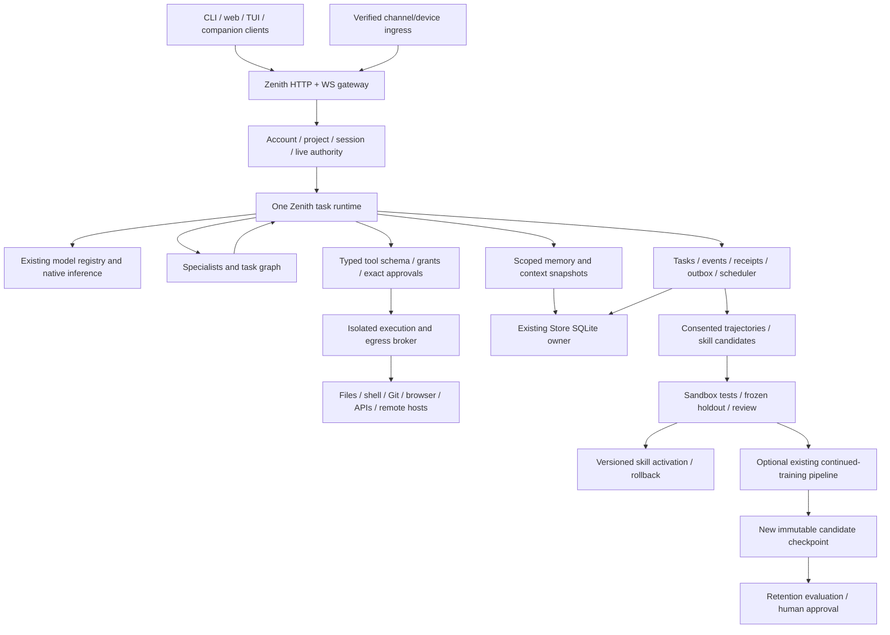

**Date:** 2026-10-25 UTC. **Scope:** audit/design only; further Zenith edits await approval of this expanded project.

OpenClaw `2f5727b9c61c2ba9dccc3c880d9115f02cb8652f`; Hermes `d05095663342556788cf2a198bfa7844cc7968ab`; Zenith main `e6963d9c6f45c196ae2e301819ae1ae093b35c41`; unmerged PR #19 `44d55d23cb946254a4a718a35a7c5432003cc01b`.

**Evidence:** S = source-verified code/declaration; D = upstream documentation/policy claim; M = actually measured; P = proposed; H = hypothesis. A manifest, tool schema, doc page or test filename does not prove successful execution. Status describes Zenith parity, not whether a reference project works.

# Proposed unified architecture (P)

## One model identity and one orchestration engine

Extend Zenith's existing Agent/provider/storage/security owners. Do not install OpenClaw and Hermes as two running agents, embed Hermes AIAgent behind a Zenith label, or create a replacement model. The preserved selected checkpoint is the default inference backend. Existing native/provider `generate`/`stream` contracts stay valid; additional structured-turn interfaces are optional and negotiated. A missing/incompatible checkpoint causes a clear unavailable/error result, never random initialization or a hidden model switch.

Inference may run in a separate private service where practical. It mounts original artifacts read-only and exposes a scoped local interface. GPU acceleration/vLLM/quantization remain optional compatibility experiments; CPU inference and the existing tokenizer/adapter stay supported. Extra logical agents do not imply extra foundation models or simultaneous GPU execution. Preserve the current generation lock until a backend's actual concurrency/batching has been measured.

## Native contracts

- `ActorContext`: server-created account/project/session identity, authentication revision and grant references. Never a model-supplied role, raw cookie or owner code.
- `ModelTurn`: text, typed tool proposals, finish reason, provider/source identity and actual usage. Strict schema-constrained local proposals may be explored, but reliability must pass actual selected-model evaluations.
- `ToolSpec`: exact ID/version, schema dialect, effects, target type, required scopes, isolation class, resource limits and output policy. Discovery and dependency availability do not authorize execution.
- `TaskRecord`: goal, step graph, checkpoints, leases/fencing token, budgets, approvals, cancellation and outcome receipts.
- `EvidenceRef`: actual ingested/retrieved source identity/version/hash/excerpt and access scope. A citation must refer to a source retrieved during execution.
- `SkillCandidate`: immutable content/parent hash, type (prompt/workflow/executable package), license/consent provenance, requested capabilities, evaluation and review records.

Model-generated calls are untrusted proposals. Validate schema and immutable argument snapshots, apply current actor/target/grant checks, acquire exact-action approval where needed, persist intent/audit receipt, then dispatch to the broker. Recheck authority after awaited preparation and immediately before effects. Post-call revocation suppresses further use, but cannot undo a completed external action.

## State, sessions and transport

One SQLite owner retains legacy accounts/conversations/memories and adds versioned `platform_*` state. Never copy Hermes state.db/MEMORY.md/USER.md or its jobs.json into production implicitly. Any optional user-authorized import is a separately tested, scoped migration with provenance and backup. Existing shared FTS stays shared; new private documents must never enter it by accident.

Lifecycle expands the PR19 supervised states with preparing, waiting-tool, waiting-approval, blocked-input and child/review phases. Compare-and-swap versions plus expiring worker leases fence old workers. Store queued intent, effect receipts, scoped events and outbox atomically. Crash after possible external acceptance becomes reconciliation, not blind replay or an exactly-once claim. Cancellation propagates to child tasks, streams, workers and scheduled runs with bounded cleanup.

HTTP and WebSocket frames are versioned and bounded. Replayed and live events apply account/project authorization; progress can coalesce, but approval/terminal records persist. Optional OpenClaw RPC and Hermes/ACP/TUI compatibility layers map tested subsets into the same task engine. Their WebSocket/JSON-RPC protocols are not MCP and are not interchangeable by renaming methods.

## Memory and context

Use existing PersonalStore/summaries/turn history as sources; add consented episodic task history, scoped search, derived semantic vectors and project knowledge. Filter authorization before content/ranking. Store confidence/provenance/expiry for inferred memories; user statements, source facts and model inferences remain distinguishable. Deletion purges derived indexes, caches and queued exports; already-produced conversation artifacts have a documented, testable retention policy.

FTS is the initial fallback. Select embeddings only after a pinned licensed model and frozen relevance/resource benchmark justify them. External memory providers require explicit data-egress consent and per-account credentials; provider/profile selection is not permission. Preserve tokenizer context limits and account boundaries during compression.

Hermes-style stable prompt prefixes are an optimization contract, not permission to hide memory changes. Keep immutable per-session system/tool snapshots; put fresh untrusted retrieval/memory in bounded data context. Explicit refresh/compression versions the snapshot and invalidates caches deliberately. Preserve tool-call/result pairs and durable pre-compression evidence; on checkpoint failure do not silently discard history. Measure cache hit/token/latency effects before changing defaults.

## Reviewed learning

Consented successful/failed executions yield redacted trajectories with actual outcomes, tool/argument schemas, versioned environment and usage. Workflow discovery finds reusable structure without copying raw secrets. A native model or deterministic extractor can propose candidates, but cannot activate them or edit production code.

Candidate → isolated tests → independent held-out evaluation → security/license review → human approval → versioned activation. Evaluate workflow success, error recovery, tool correctness, privacy, retained tasks, latency/tokens and rollback. Failures remain failures; human-assisted rescue is scored separately from autonomous success. New skill versions cannot expand live grants. Reference curator defaults or scanners do not waive this gate.

Optional neural training reuses Zenith's existing continued-training and checkpoint owners. Preserve immutable parent hashes, tokenizer compatibility, training-only replay and held-out isolation. Do not train on secrets, private data without consent, or provider outputs without applicable rights. A skill/memory update is not a weight update. A candidate checkpoint requires retention evaluation and explicit approval before reversible deployment.

## Multi-agent and tools

The supervisor configures coding, research, data, infrastructure, cybersecurity, planning, memory, testing, documentation and automation postures. Children receive distinct task/workspace identity, strict-subset permissions, aggregate budgets and cancellation. No implicit administrator/MFA inheritance. Controlled task/evidence/attachment interfaces replace shared ambient global state.

Files/shell/Python/Git/database/infrastructure operations go through the same broker and policy engine. Use isolated worktrees and record changes/tests; never silently commit, push, publish or mutate remote infrastructure. Low-risk reads and high-impact writes have distinct grants. Database/SSH/Docker credentials are scoped handles, not model text. A Docker control capability talks to a privileged broker; workers never receive the host Docker socket.

MCP/plugin/skill metadata is untrusted. Validate bounded manifests, schema/version negotiation, pinned artifact hashes and requested effects before code import. Unknown dependencies or updates require review. Run untrusted executable packages in isolated workers, not the gateway. Prefer native reusable implementations and small attributed ports over importing a second agent core. Passive status/discovery does not install packages or open network connections.

## Channels, automation and media

Every source integration has a separate matrix row and native protocol facet profile. One canonical adapter can support reference-specific variants, but QR/personal WhatsApp and official Cloud API, or WeCom bot versus callback app, stay distinct modes with distinct tests/credentials. Pair verified external account/sender/chat/thread/device identities to Zenith accounts. Reject forged/replayed ingress and protect outbox delivery from duplicate accepted writes. Notifications and scheduled sends require explicit target authority.

Schedules/triggers/heartbeat jobs use durable leases, timezone/DST/misfire/overlap policy and expiring standing service grants. They never convert a login cookie or old MFA elevation into permanent authority. Secrets stay outside model prompts and ordinary logs.

Browser and computer execution require real isolated profiles/VMs, origin-bound vault handles and all-subresource/DNS/redirect/IPv4/IPv6 egress controls. Do not import the owner's host cookies/keychain by default. Human approval binds uploads, downloads, sends, payments and sensitive credential operations to exact targets. Media decoders and OCR/STT/TTS/vision/video workers are bounded and optional; arbitrary encoders do not become compatible with Zenith's tokenizer/embeddings automatically.

## UI, deployment and release boundary

Keep the current logo, chat and installation flow. Add optional task/model/source/permission/memory/candidate/performance controls with clear unavailable states and real model attribution. TUI/desktop/mobile clients are clients of the same engine, not separate agents. Use platform-native code only where needed and verify on actual target OS/device/toolchains.

All new features start disabled. Scope-specific security/E2E and paired behavior/performance tests precede activation. Rollback stops admission, revokes affected grants and drains/fences workers, then disables flags/reverts compatible code while leaving additive data and audit history intact. Never overwrite a checkpoint or restore an older database over newer user changes silently.

No new code implementing this architecture is part of this audit. The exact proposal and blockers are in the file plan and parity report.
